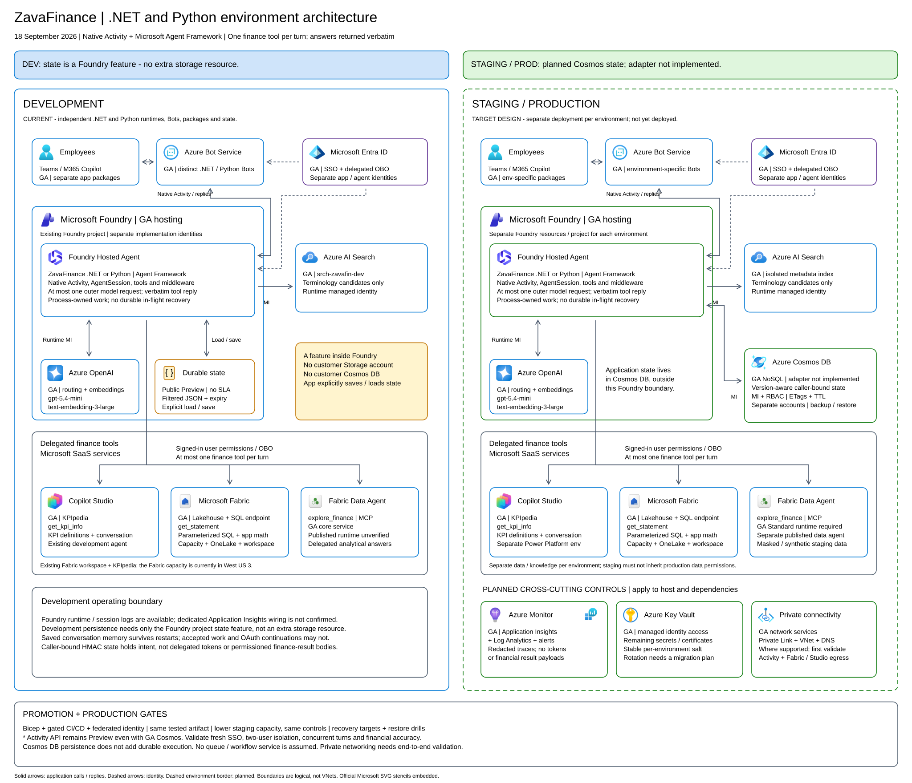
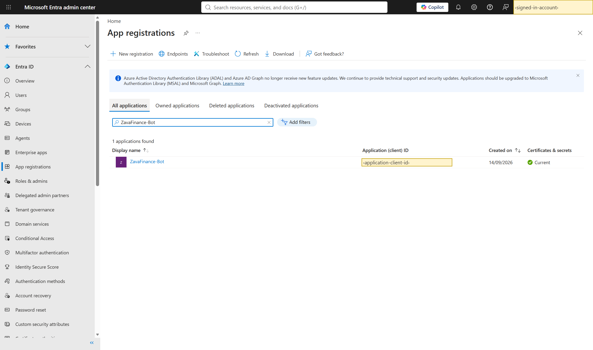
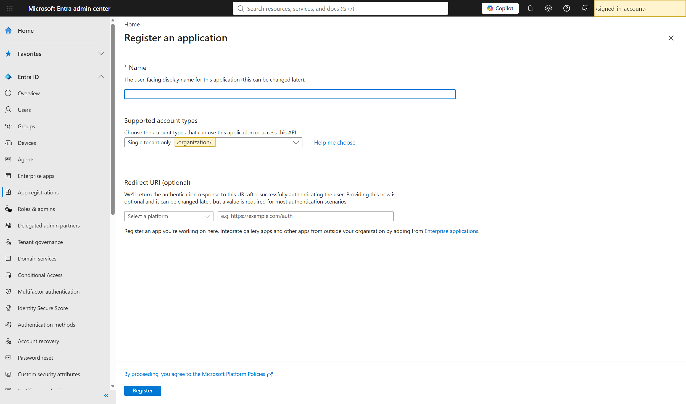
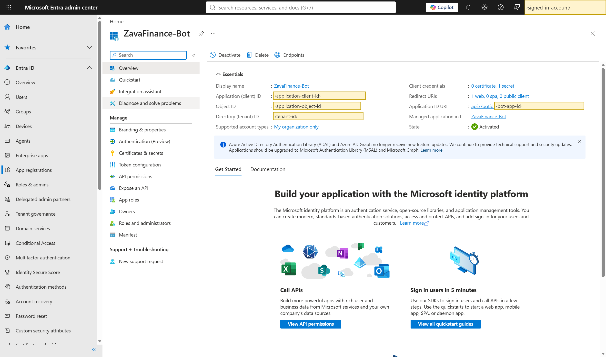
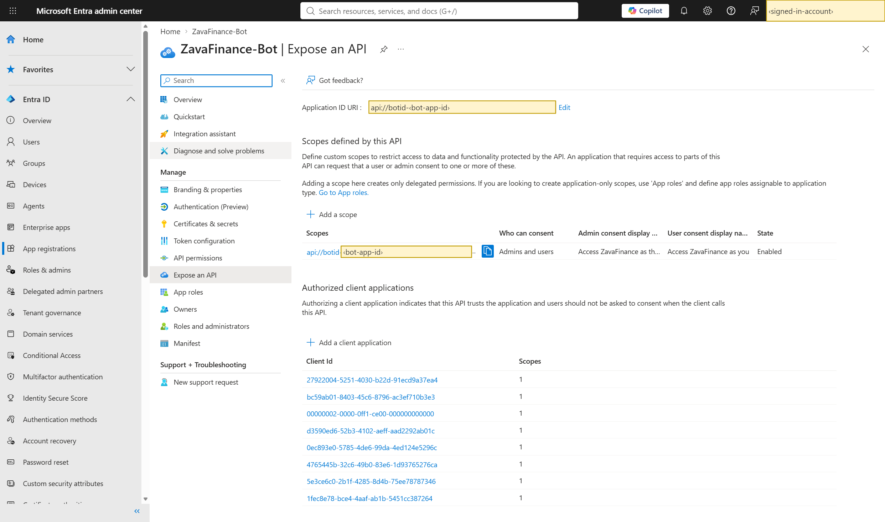
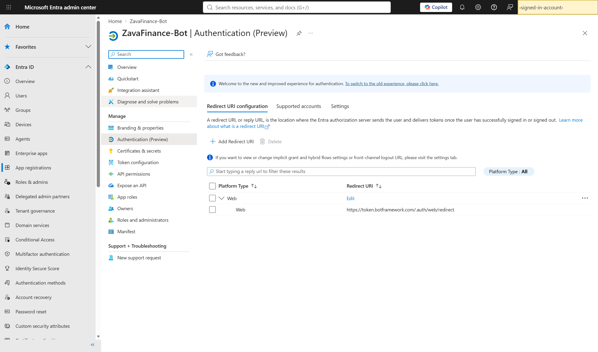
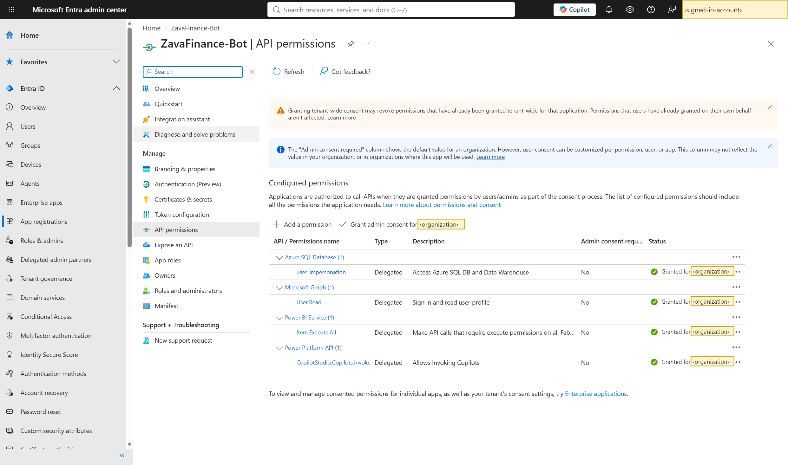
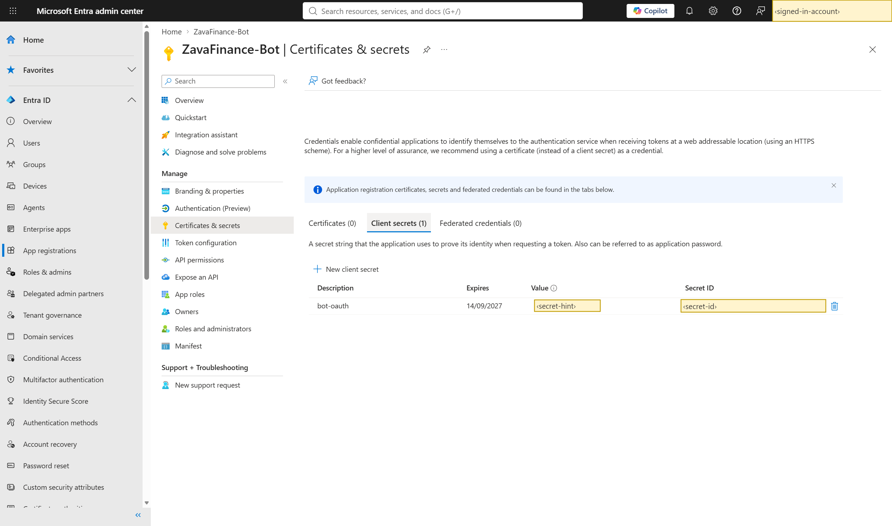
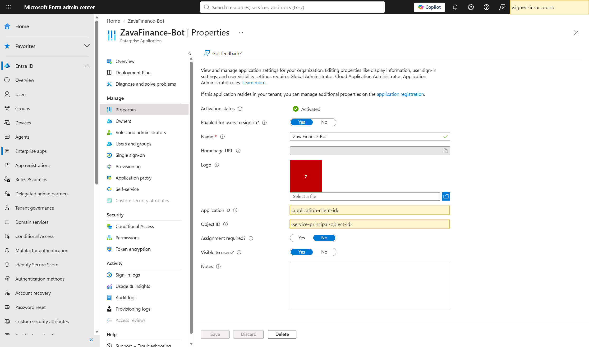
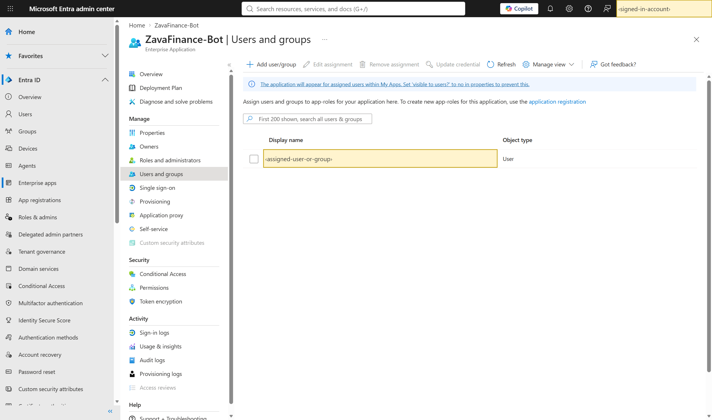

# ZavaFinance: customer IT installation and configuration guide

## 1. Purpose and installation boundary

> **Document status: DRAFT - IT readiness review.** Edition 1.3, 5 October 2026. Share this guide for architecture, access, networking, licensing and responsibility review. It is **not a complete deployment handover or installation sign-off**. The outstanding delivery dependencies below must be closed for the selected implementation before a deployment-ready handover.

**Audience:** customer Azure platform, identity, network, Microsoft 365, Fabric, Power Platform and application-release administrators. **Review date:** 5 October 2026. This guide applies to either the .NET or Python implementation; installing both is optional.

### Recommended handover closure plan

The following items are **not closed in the current customer handover**. A prerequisite listed later in this guide is not evidence that its artifact has been supplied or validated. Supplying migration scripts does not mean that the actual working agent or finance dataset has been exported, reconciled and accepted, or that dependency delivery has been fixed.

| Outstanding delivery dependency | Required closure evidence | Accountable owner |
| --- | --- | --- |
| **R1. Fabric Data Agent configuration** | Reviewed export/readback of the working agent, translated into customer-specific setup: actual instructions/prompts, selected sources/tables, approved example questions/queries and expected results, runtime settings, publication/MCP binding and user permissions. A generic replacement prompt is not equivalent. | Fabric/Data Agent owner, with finance review |
| **R2. Base finance dataset and full schemas** | Approved data for all nine source tables (synthetic/non-production for this baseline), complete column types and data contracts, loading or validated migration procedure, row counts/period coverage and independently reconciled totals. Resolver scripts do not create these original facts; migration tooling is not evidence of an actual delivered data release. | Finance/data owner |
| **R3. Reproducible .NET dependency delivery** | Approved feed or distributable dependency pack, pinned versions, provenance/redistribution approval, and successful restore/build on a clean workstation. The host currently relies on a source-built Activity compatibility package and local artifact feed. **Applies only when .NET is selected.** | Application release owner and software/package approver |
| **R4. KPIpedia delivery or validated reuse** | Importable Power Platform solution with knowledge, environment variables, connection references and access requirements, **or** an approved existing compatible agent with a verified delegated invocation. An existing generic KPI service is not automatically compatible with this release. | Power Platform/KPI owner and application release owner |

**Recommended sequence:** assign these owners now; collect and approve the artifacts; rehearse the documented installation from a clean workstation into an authorized customer-like development environment; correct any undocumented steps; then obtain the evidence-based approval in [Section 19](#19-installation-handover-and-sign-off). For a Python-only release, record R3 as not applicable with the selected scope; do not treat the Python build or remote SQL-library compatibility as already validated.

Customer-specific licensing/capacity, identity consent/RBAC, network and Preview-policy decisions are separate installation approvals, not missing software artifacts. The guide covers those checks, but the customer's owners must execute and record them. The supplier demonstration is not that evidence.

**Recommended operations addition:** deliver tested log queries/dashboards, agreed alert thresholds and owners, and a rollback/credential-rotation exercise record. Section 16 describes this recommended operations pack; its inclusion here does not mean it has been implemented.

The customer creates and owns the resources in its development environment. Resource provisioning, identity and channel configuration are portal-first and do **not** depend on supplier provisioning scripts. **Data operations are an explicit exception:** the reviewed resolver publication/validation scripts install required metadata; the separate estate-migration toolkit preserves an existing supported Fabric estate. Section 6 distinguishes these paths. Microsoft command-line tools are used for native code deployment and the controlled Fabric/OneLake transfer. This is **not a claim that every step is available in a portal**.

This guide is a draft installation and acceptance specification, not a software distribution or a release approval. The application owner must deliver the artifacts in Section 3 before installation. Empty Azure resources alone cannot supply the application, finance data model, KPI knowledge or resolver index.

### What the customer is installing

Employees use a Teams / Microsoft 365 agent. Azure Bot Service routes their messages to a native Activity application hosted in Microsoft Foundry. The application selects a finance capability:

- **KPI definitions:** the customer's published Copilot Studio KPIpedia agent.
- **Financial statements:** authorized Fabric SQL queries and application-owned calculations.
- **Exploratory analysis:** the customer's published Fabric Data Agent MCP endpoint.

The runtime managed identity accesses models, embeddings and Azure AI Search. Financial access uses the **signed-in employee's delegated permissions**. Bot authentication, managed identity access and employee authorization are separate controls.

### Development scope

The baseline is one Entra tenant, Azure public cloud, approved non-production data and a named pilot group. Existing services may be reused with owner approval. Use separate resource and identity boundaries for staging and production.

For each selected implementation, create a distinct hosted agent, Bot registration, installed app identity and state boundary. Models, Search and approved finance dependencies may be shared. Never point both Bots at one endpoint merely because the applications have similar names.

> **Approval gates:** the Activity messaging route is preview-versioned; Foundry-managed state is Public Preview without an SLA. Private-only networking, prohibition of client secrets, or prohibition of Preview can prevent installation of this release. Resolve these gates before purchasing capacity. Do not bypass customer policy.

### Start here: how to use this installation guide

1. **Choose one implementation first:** .NET or Python. The user-facing capabilities are the same. Install both only when the application owner explicitly needs both.
2. **Name the owners below.** An Azure engineer cannot normally approve tenant consent, publish a Teams app or grant Fabric data access alone.
3. **Collect the delivery pack before creating resources.** Obtain the approved base finance dataset or a separately rehearsed migration of the actual source estate. Seeding creates resolver metadata and its Search projection, not original finance facts. Migration copies existing data/history; it does not supply a missing source dataset or a working-agent acceptance record.
4. **Complete the dependency-ordered checklist below.** Record each resource's actual identifiers in the worksheet. Do not copy the example resource names, tenant IDs or regions from a demonstration environment.
5. **Use the detailed procedure referenced by each row.** Do not proceed past a failed completion check. Ask the named owner to fix it instead of adding broad permissions.
6. **Finish with two-user acceptance.** A green deployment indicator or an administrator receiving an answer does not prove that ordinary users have the correct access or that the answer is financially correct.

The full Azure-stencil architecture and enlarged environment views are in [Section 21](#21-environment-architecture). The tables here are the installation map; the diagram is not a requirement to provision the planned production components.

### Terms and identifiers: do not interchange these

| Term | Plain-language meaning |
| --- | --- |
| Entra tenant | The organization's identity directory. An Azure subscription, Fabric workspace and Microsoft 365 users must belong to the approved identity arrangement. The baseline assumes one tenant. |
| Subscription / resource group | Azure's billing/governance boundary and a container for Azure resources. Creating a resource group does not create the services inside it. |
| Resource ID / scope | An Azure management path identifying the resource. The scope of an RBAC grant says where the permission applies. |
| RBAC / IAM | Role-based access control. Azure portal calls its assignment page **Access control (IAM)**. A role answers what a principal can do at a scope. |
| Principal / object ID | The user, group, service principal or managed identity receiving a permission. Assign roles to the actual object's ID, not merely a similar display name. |
| Application (client) ID | Identifies an Entra application during sign-in. It is not the app object's ID or its enterprise application's service-principal object ID. |
| Managed identity (MI) | An Azure-managed application identity. The host uses it for model and Search access; it is not an employee and must not replace employee finance permissions. |
| Delegated / OBO | The application calls a downstream service on behalf of the signed-in employee. Both application consent and that employee's data access are needed. |
| Endpoint / deployment name | An endpoint is the service address. A model deployment name identifies a deployed model inside the service; a catalogue model name alone is not sufficient. |
| Bot routing identity / finance OAuth app | The first connects messaging to the hosted agent. The second obtains employee tokens for finance services. They are separate purposes and their client IDs need not match. |

### Component inventory and dependency map

**Required** means required for this three-capability development solution, even when reusing an existing service. **Per implementation** means a separate instance or binding for .NET and Python if both are installed. C-numbers below are worksheet references, not Azure resource names.

| Component and where to create/configure it | Dependencies and purpose | Settings to record before proceeding |
| --- | --- | --- |
| **C1. Azure development subscription and RG**. Azure portal. Required. | Approved tenant, budget, location/SKU policies and authorized platform owner. Contains the Azure services below. | Tenant ID, subscription ID, RG, approved region, resource tags and owners. |
| **C2. Foundry account and project**. Foundry / Azure portal. Required. | C1, regional hosting capacity and approved network mode. Runs the application and exposes the project APIs. | Account/project resource IDs, exact project endpoint, project identity and hosting availability. |
| **C3. Routing and embedding model deployments**. Foundry model deployment experience. Required. | C2 or approved connected model account, model quota and data-geography approval. | Routing deployment/version; embedding endpoint/deployment. Baseline: `gpt-5.4-mini`, `text-embedding-3-large`, requested vector size **1536**. |
| **C4. Azure AI Search**. Azure portal. Required. | C1, vector/semantic-capable tier, semantic ranker, Entra RBAC and network access. Searches finance terminology, not financial facts. | Search endpoint/resource ID; schema, documents and index name supplied by C6. |
| **C5. Fabric capacity, workspace and finance lakehouse**. Fabric portal; capacity through the approved Fabric/Azure administration route. Required. | Active licensed capacity, Fabric owner, approved data release and source permissions. Separate SaaS administration, not just Azure RG creation. | Capacity/region, workspace/lakehouse IDs, SQL hostname/database, nine source tables and approved data totals. |
| **C6. Resolver tables and Search release**. Included scripts, run by the data publisher. Required. | C5 **already populated**, C3 embeddings, C4 Search, publisher permissions and SQL client dependencies. Resolves names to allowed organizations/KPIs. | Immutable catalogue version, versioned Search index, `resolver-semantic`, embedding binding, validation results and active singleton release. |
| **C7. Published Fabric Data Agent**. Fabric portal. Required. | C5, approved AI tenant settings, instructions, source/item permissions and publication. Provides analytical exploration. | Workspace/item ID, published MCP endpoint, chosen runtime, source permissions. |
| **C8. Published Copilot Studio KPIpedia agent**. Copilot Studio / Power Platform admin center. Required. | Approved environment/licensing, importable solution or existing agent, knowledge, sharing and DLP. Provides KPI definitions. | Environment ID, agent schema/name, solution version, connections and user access. |
| **C9. Finance Entra app registration and enterprise app**. Entra admin center. Required. | Tenant authority, exposed finance scope, downstream delegated API contracts for C5/C7/C8, admin consent and credential policy. | Client ID, tenant ID, object/SP IDs, Application ID URI, scope, accepted audience, redirect URI, secret custody/expiry and assignments. |
| **C10. Native hosted finance agent**. Deploy with public azd tooling to C2. Per implementation. | Approved application release, C3/C4/C6/C7/C8/C9 settings, supported hosting runtime, network and runtime permissions. | Agent name/version, active endpoint, actual runtime principal, native Activity configuration and tested health. |
| **C11. Azure Bot Service and OAuth connection**. Supported Foundry publication flow, then Azure portal verification. Per implementation. | C10 routing identity/endpoint, C9 finance OAuth configuration and publishing permissions. Routes messages and retrieves user tokens. | Bot resource ID, routing client/tenant ID, Activity messaging endpoint, **`mcs`** OAuth connection, token-exchange URL and Teams channel. |
| **C12. Teams / Microsoft 365 app and pilot users**. Supported publication/package flow and customer app administration. Per implementation. | C11, manifest matching C9/C11, approved package/policy, user licences and user authorization. | App ID/version/name, Bot ID, `webApplicationInfo` fields, app availability/installation and authorized pilot group. |
| **C13. Foundry-managed conversation state**. Application/platform feature, not a separate Azure storage deployment. Per implementation. | C2/C10 and a stable, secret, caller-key salt. Stores filtered conversation memory; Public Preview without SLA. | Effective store name, unique salt reference, successful write/reload test and retention. **No customer Cosmos or Storage account for this development baseline.** |

**Optional or policy-dependent development components:** Application Insights/Log Analytics for approved telemetry, Key Vault for secret custody, and private connectivity/DNS where the complete integration supports it. Creating these resources does not automatically wire the application to them. The production Cosmos adapter and staging/production deployment are not part of this installation.

### Permissions at a glance: who needs access to what

Have the access owner record **principal object ID + role/permission + exact scope + expiry** for every grant. Human setup permissions, runtime permissions and employee data permissions are different; never copy the installation administrator's permissions onto the runtime.

| Who | Grant and target | Why / important limitation |
| --- | --- | --- |
| Azure platform provisioner | **Contributor** or narrower approved write role on C1's dedicated RG | Creates resources. Does **not** grant permission to assign Azure roles or grant tenant consent. |
| Azure access administrator | Scoped **Role Based Access Control Administrator**, **User Access Administrator**, or equivalent approved assignment-write authority | Assigns the approved roles. Prefer temporary/PIM access; not subscription-wide Owner for convenience. |
| Application deploy/publish operator | **Foundry Project Manager** on C2; **Azure Bot Service Contributor Role** on the Bot publishing RG for C11 management | Native source deployment and Bot administration are separate permissions. Project Manager is not arbitrary role-assignment authority. See Section 9's role qualifications. |
| C10 runtime managed identity | **Cognitive Services OpenAI User** on the actual C3 model account(s); **Search Index Data Reader** on C4 | Inference, embeddings and terminology lookup. No Search write role and no publisher-level finance access. Assign once the runtime's actual identity exists; then verify. |
| C6 data publisher | Fabric **Contributor** or approved equivalent create/run-notebook and lakehouse read/write access; SQL SELECT on required source/resolver objects | Creates/runs the publication notebook and reads the resulting SQL tables. SQL read access alone cannot write through Spark/OneLake. |
| C6 data publisher | **Search Service Contributor** and **Search Index Data Contributor** on C4; **Cognitive Services OpenAI User** on the embedding account | Creates index schema, uploads catalogue documents and generates vectors. These are not runtime permissions. |
| Identity/application administrator | Approved Entra app-management authority on C9; separately authorized consent approver for the required delegated permissions | Azure RG Contributor does not administer Entra. The required consent role depends on the API grants and tenant policy; do not give everyone Global Administrator. |
| Power Platform / KPI owner | Approved environment maker/agent-management access for C8; Power Platform administrator for tenant/DLP decisions | Import/configure/publish and share KPIpedia. Azure IAM cannot grant these permissions. |
| Teams / Microsoft 365 administrator | Approved app-management authority and policy control for C12 | Approves/distributes the package and checks licensing. Installing an app does not consent finance APIs or grant data access. |
| Ordinary pilot employee | **Foundry Agent Consumer** at the supported narrow agent scope under `BotServiceRbac`, plus permitted Fabric item/SQL and KPIpedia access, enterprise-app assignment if required, and M365 licence/app availability | Each gate must pass. Do not make pilot employees Fabric workspace administrators. Narrow Foundry role scope can require CLI rather than portal assignment. |
| Bot/platform identity | Supported C10/C11 publication-generated authorization bindings | **`BotServiceRbac` is a scheme, not a role to search for in IAM.** Verify the flow's actual principal/role/scope; do not invent a broad substitute. |

**How to grant an Azure role:** open the **target resource > Access control (IAM) > Add role assignment**, choose the exact role and principal, review the scope, then verify **Check access**. Assign model roles on the model account and Search roles on the Search service, not on similarly named resources. Section 9 covers assignment authority, propagation and the exceptions requiring public CLI tooling.

### Settings that connect the components

Use the [configuration worksheet](#customer-configuration-worksheet) to collect values before deployment. These are logical inputs; Section 10 gives the exact .NET/Python runtime key mappings.

| Connection | Required setting or binding | Obtain it from / common mistake |
| --- | --- | --- |
| Release workstation to C2 | `AZURE_SUBSCRIPTION_ID`, `AZURE_RESOURCE_GROUP`, `AZURE_AI_PROJECT_ENDPOINT` | Approved Azure/Foundry resources. A model inference endpoint is not a project endpoint. |
| C10 to C3 | `ModelDeployment`, model-account endpoint required by the delivered manifest; `RESOLVER_EMBEDDING_ENDPOINT` | Actual deployed model names and account endpoints. Do not confuse the Foundry project endpoint with the embedding account endpoint. |
| C10 to C4/C6 | `RESOLVER_SEARCH_ENDPOINT`; index/deployment/dimension tuple in `resolver_release` | Search service plus the verified data release. Do not activate an index before catalogue and vector checks pass. |
| C10 to C5 | `FABRIC_SQL_ENDPOINT`, `FABRIC_DATABASE` | Lakehouse SQL analytics connection details. Needs TCP 1433 from the hosted runtime, not just an HTTPS proxy on a laptop. |
| C10 to C7 | `FABRIC_WORKSPACE_ID`, `FABRIC_DATA_AGENT_ID` | Actual **published** Fabric Data Agent; creating an unpublished draft is insufficient. |
| C10 to C8 | `COPILOT_STUDIO_ENVIRONMENT_ID`, `COPILOT_STUDIO_SCHEMA_NAME` | Published KPIpedia settings. The friendly display name is not necessarily its schema name. |
| C10 and Bot OAuth to C9 | `OBO_TENANT_ID`, `OBO_CLIENT_ID`, `OBO_AUDIENCE`, runtime credential; corresponding Bot OAuth settings | Finance OAuth registration. Bot routing client ID is not an interchangeable replacement. Runtime and Bot credential updates are separate. |
| C11 to C10 | Published native Activity messaging URL, routing client/tenant ID, `BotServiceRbac` | Supported publish flow's output. Do not type a guessed `/messages` path. |
| C12 to C9/C11 | Manifest Bot ID, `webApplicationInfo.id`, `webApplicationInfo.resource`; OAuth **`mcs`**, finance scope and token-exchange URL | Customer-specific app package and approved SSO contract; exact comparisons in Sections 8 and 12. |
| C10 to C13 | .NET `ONE_SESSION_KEY_SALT` or Python `PYTHON_SESSION_KEY_SALT`; effective state-store name | Generate and protect a distinct stable salt per implementation/environment. Redeploying must not silently rotate it. |

Client IDs and endpoints are configuration, not credentials, but still belong in a controlled customer record. **Never put client-secret values, access tokens, state salts or financial records into this PDF, screenshots or a support ticket.**

### Installation order and stop/go checks

Work top to bottom. Several owners may prepare independent prerequisites in parallel, but do not skip a predecessor's completion check.

| Step / owner | Action and detailed procedure | Do not continue until |
| --- | --- | --- |
| **1. Release and policy owners** | Choose variant; receive approved source/dependencies, data and seeding pack. Review licensing, Preview/secret policy and networking. Sections 2-4. | Required artifacts exist and exceptions are approved. Missing base finance data blocks C6. |
| **2. Azure platform owner** | Create/select C1-C4; deploy models, enable Search semantic ranker and approve network paths. Section 5. | Resource IDs/endpoints, quotas, region and connectivity are recorded. |
| **3. Fabric/data owner** | Prepare C5. Either load the approved baseline and run C6 **stage > validate > index > activate**, or migrate the actual estate into isolated targets and follow the separate publication gates. Section 6. | SQL/data checks pass; user access is verified; one approved active release matches target Search. Do not regenerate an imported catalogue. |
| **4. Fabric and KPI owners** | Publish/share C7 and C8; validate each with a normal employee identity. Sections 6-7. | Real published endpoints exist and the intended user can access each dependency. |
| **5. Identity and access owners** | Configure C9, scopes/redirect/consent, assignments and approved credentials. Preassign human setup access; prepare runtime grants. Sections 8-9. | Finance identity values and consent are correct; the credential policy can be met. |
| **6. Application release owner** | Configure and deploy C10, provisioned C13 feature included. Identify runtime MI and apply its approved C3/C4 roles. Sections 9-11. | Agent is healthy; real runtime model/Search/state tests pass; no unexpected broad access. |
| **7. Publishing and identity owners** | Publish to C11, verify native Activity routing, Teams channel and finance OAuth **`mcs`**. Section 12. | Supported endpoint/auth bindings, OAuth fields and channel route are correct. |
| **8. M365 administrator** | Finalize/approve C12, restrict app availability to the pilot and install for test users. Section 13. | Correct app is discoverable and sends a real message to the intended agent version. |
| **9. Security/data/application owners** | Run fresh SSO, positive/negative two-user access, deterministic financial checks and restart/retry tests. Section 14. | Evidence is signed off; failed or untested checks remain explicit blockers. |
| **10. Operations and development owners** | Record support, monitoring, rollback and local-development/release workflow. Sections 15-19. | Named owners can reproduce deployment and operate/retire the environment. |

**If a step fails:** record the component, caller identity, operation, time/correlation ID and sanitized error. Check the matching role **and** network path. Refer to Section 17. Do not resolve a `403` by granting Owner or resolve a DNS/private-endpoint problem by broadly enabling public access.

## 2. Services and availability

The table lists **service and feature status, not SDK status**. GA status does not establish availability in a particular region, entitlement, quota or compatibility of a private-network combination. Reconfirm at change approval.

| Service | Customer development requirement | Status / important qualification |
| --- | --- | --- |
| Azure subscription and resource group | Approved development subscription and dedicated RG, or approved split RGs | GA |
| Microsoft Foundry account and project | One approved baseline project for the selected implementations | GA core service; verify native code hosting in the chosen region |
| Foundry Hosted Agents | One native hosted application per implementation | GA hosting service; selected Activity messaging API is **Preview-versioned** |
| Azure Bot Service | One registration per implementation | GA; routing, channels and OAuth must be configured |
| Foundry-managed durable state store | One named application store and stable secret salt per implementation | **Public Preview; no SLA**. No separate customer Storage or Cosmos account is required for this development state |
| Azure OpenAI model deployments | Routing / reranking model and embedding model | Baseline GPT-5.4-mini and text-embedding-3-large are GA models; approve exact versions, deployment types and regions |
| Azure AI Search | Vector and semantic-capable service; versioned resolver index | GA; selected tier, region and semantic ranker must support the workload |
| Microsoft Entra ID | Finance OAuth app, enterprise application and platform/runtime/Bot identities | GA core identity; consent and Conditional Access policies apply |
| Microsoft Fabric | Active capacity, workspace, finance lakehouse and SQL analytics endpoint | GA core capabilities; capacity and user permissions are separate from Azure RBAC |
| Fabric Data Agent | Published agent connected to approved finance sources | Standard runtime **GA**. Reviewed MCP documentation does not separately declare every MCP integration GA |
| Copilot Studio / Power Platform | Approved environment and published KPIpedia agent | GA service; licensing, agent sharing and DLP approval required |
| Teams / Microsoft 365 Copilot | Licensed, authorized pilot users and approved app-distribution route | GA services; confirm entitlement for each intended user experience |
| Application Insights / Log Analytics | Recommended operations destination | GA; resource creation alone does not instrument the application |
| Azure Key Vault | Recommended custody for application credentials and state salts | GA; this release does not automatically resolve Key Vault references |
| VNet, Private Link, Private DNS, firewall | Conditional on the customer network design | GA services; exact native Activity and hosted-egress compatibility remains a separate gate |
| Cosmos DB for NoSQL | **Not required for the development baseline** | GA; planned for staging and production, but the application adapter is not implemented |

**Do not provision by default:** AKS, App Service, Container Apps, Functions, a VM, customer ACR, Service Bus or a customer Storage account for conversation memory. These are not separate runtime dependencies of the selected native-code hosting design.

Azure hosting/model/Search costs, Fabric capacity, Copilot Studio usage and Microsoft 365 licensing may have different billing owners. Estimate all of them. Set budget alerts, quota limits and named owners; budget alerts are not spending caps.

## 3. Before installation: approvals and delivery pack

### Assign accountable owners

| Owner | Required responsibility |
| --- | --- |
| Azure platform administrator | Subscription/RG, providers, resource creation, quota, model deployments and platform access |
| Identity administrator / consent approver | Finance app registration, exposed API, downstream delegated permissions, enterprise-app assignment and credentials |
| Network / security administrator | Workstation access, hosted egress, Bot ingress, private DNS, TLS inspection, data residency and policy exceptions |
| Fabric / finance owner | Capacity, data model, source permissions, resolver release, published Data Agent and reconciled financial test cases |
| Power Platform administrator | Environment, KPIpedia import/configuration, sharing, publishing and DLP |
| Teams / Microsoft 365 administrator | App approval, installation policy, pilot availability and licensing |
| Application release / support owner | Deployable application, configuration contract, native-code deployment, app package, troubleshooting and rollback |

One person may hold several responsibilities, but Azure subscription ownership does not grant tenant consent, Fabric data access or Teams administration.

### Required software and data delivery pack

Obtain the following through the customer's approved software-transfer process. Record the release ID and hashes. **Stop if required artifacts are absent; do not reverse-engineer schemas or substitute a generic chatbot.**

Track the outstanding R1-R4 dependencies from Section 1 against this checklist. Listing an item here does not mark it as delivered. The seeding archive contains reviewed resolver sources, not the missing base dataset, Fabric Data Agent configuration, .NET dependency pack or KPIpedia solution.

1. **Application release workspace:** the chosen runtime payload, a reviewed native-code deployment manifest and public-tool instructions. Its resource/channel deployment must contain no supplier provisioning hooks or helper-script dependencies, customer credentials or demonstration resource IDs. The separately reviewed data-seeding scripts below are the explicit exception.
2. **.NET release workspace:** the real host project, referenced source projects, dependency configuration and approved compatibility-package feed for the native `dotnet_10` runtime. The documented azd bundled flow publishes this project on the release workstation/runner; a DLL or ZIP alone is not sufficient. Supply reproducible feed access/artifacts and record dependency provenance and redistribution approval. IT must not need an undocumented private developer build machine.
3. **Python payload:** source/package layout for native `python_3_13`, pinned requirements and the approved remote-build dependency sources. The managed Linux SQL/native-library compatibility must have been tested.
4. **Finance data and seeding/migration release:** approved base data for the nine source tables, exact schemas/totals and permission design. The **`zavafinance-fabric-seeding.zip`** scripts generate resolver metadata, not original facts. For an existing-estate migration, additionally obtain the separately reviewed migration toolkit and actual approved export package, independent manifest approval, mapping and rehearsal evidence. The seeding ZIP is not a migration distribution or finance backup. Include the approved SQL-client dependency folder or source/feed access needed to build it. Section 6 defines both paths.
5. **Search release:** the reviewed `Publish-ResolverSearch.ps1` in that pack creates the exact vector/semantic schema and generates/validates the corresponding catalogue vectors. Alternatively, supply an equivalent complete index definition and document/vector payloads through the customer's approved deployment process. Record the version, dimensions and checksums either way.
6. **KPIpedia delivery:** a customer-importable Power Platform solution or an approved existing agent, with environment variables, connection-reference requirements and knowledge/data entitlements. A display name alone is not an importable agent.
7. **Fabric Data Agent specification:** allowed sources/tables, instructions, approved examples, runtime choice and expected finance permissions.
8. **Teams / M365 package specification:** manifest template, supported schema, icons, names, publisher/support/privacy/terms URLs and the required routing/OAuth fields. Its final customer IDs are filled only after publication.
9. **Acceptance pack:** normal and restricted pilot users, questions, expected financial values, SSO/isolation tests, operational checks and support contacts.

Resource provisioning and channel configuration do not require supplier automation. The supplied seeding scripts are an approved, reviewable path for installing the exact resolver structures; the customer's data team may use an equivalent controlled process only if it preserves the same schema, validation and release-activation contract.

### Customer configuration worksheet

Maintain one controlled record per environment. Store secret values in the approved secret system, not in this worksheet.

| Record | Required values |
| --- | --- |
| Governance | Tenant ID, subscription ID, RG(s), permitted regions, customer naming/tags, cost centre, release owner |
| Foundry / models | Account/project ARM IDs, project endpoint, model deployment names and versions, deployment geography/type, quota |
| Search / catalogue | Search ARM ID/endpoint, active catalogue version, index name, semantic configuration, embedding endpoint/deployment/dimensions |
| Fabric | Capacity/region, workspace/lakehouse IDs, SQL hostname/database, Data Agent ID, published runtime and MCP endpoint |
| Power Platform | Environment ID, published KPIpedia schema/name, solution version, connection owners |
| Finance OAuth | Tenant, client ID, application object ID, service-principal object ID, exposed scope, token version, accepted audience, consent record |
| Per implementation | Agent name/version, runtime identity IDs, Bot resource and routing client/principal IDs, OAuth connection/resource, app-package ID/version |
| State / operations | Unique store name, secret-salt reference, credential references/expiry, telemetry destination, retention, support group |

## 4. Network and policy approval

Approve three independent paths: **administrator/developer access**, **hosted application outbound access**, and **Bot/M365 inbound delivery**. A working laptop or Azure portal session proves none of the hosted-runtime paths.

### Required traffic

| Source to destination | Protocol | Purpose / validation |
| --- | --- | --- |
| Workstation / release runner to Microsoft sign-in, Azure Resource Manager and Foundry deployment endpoints | HTTPS 443 | Sign-in, provisioning, code upload and deployment readback |
| Build boundary to approved package/tool repositories | HTTPS 443 | Public tooling and dependency restore; remote build has its own egress |
| Microsoft-hosted code provisioning to documented platform image/auth endpoints | HTTPS 443 | Hosting prerequisites remain even with a bundled application |
| Teams/M365 client to Microsoft 365 and sign-in services | HTTPS 443 | App discovery, installation, SSO and conversation |
| Bot/channel service to the published Foundry Activity endpoint | HTTPS 443 | Authenticated incoming messages |
| Hosted application to Bot Connector/token services and Entra | HTTPS 443 | User-token retrieval, OBO, signing-key rollover and delayed replies |
| Hosted application to model, embedding and Search resource endpoints | HTTPS 443 | Managed-identity inference and metadata retrieval |
| Hosted application to Fabric SQL analytics endpoint | TLS / TCP 1433 | Delegated SQL queries; an HTTPS proxy is not a SQL tunnel |
| Hosted application to Fabric MCP endpoint | HTTPS 443 | Delegated analytical requests and streaming responses |
| Hosted application to environment-specific Copilot Studio services | HTTPS 443 | Delegated KPIpedia access |
| Hosted application to Foundry managed-state service | Supported platform route | Actual load/save test; readiness alone does not exercise state |
| Operators/runtime to approved telemetry and secret-delivery destinations | Service-specific approved route | Validate configured integration rather than assuming it exists |

This is a flow matrix, **not a complete firewall allowlist**. Use actual resource endpoints and current Microsoft service endpoint guidance. OAuth audiences are not necessarily network destinations; for example, `https://database.windows.net/` is not the Fabric SQL hostname.

### Private networking decision

Teams/M365 adapters cannot reach the Foundry project private endpoint. The documented private-Foundry publication design uses a scoped public Activity exception:

```text
agent_endpoint.protocol_configuration.activity.enable_m365_public_endpoint
```

The public messaging route is:

```text
https://<account>.services.ai.azure.com/api/projects/<project>/agents/<agent>/endpoint/protocols/activityProtocol?api-version=2025-05-15-preview
```

Microsoft's edge provides TLS, channel-source restrictions and authentication/authorization. Other routes may remain private. This is **not customer-VNet-protected Teams ingress**. A policy prohibiting any public agent route blocks this documented design. Do not add an internet-facing proxy, DNAT or customer public IP as an assumed workaround.

A private endpoint on Foundry or Search does not attach the hosted application to a customer VNet. Validate the exact **native Activity + direct-code runtime + region + private egress + managed state** combination before sign-off. General Responses-agent managed-network documentation is not that evidence. Managed-network FQDN rules covering ports 80/443 do not solve direct SQL on port 1433.

**Exit evidence:** approved topology and exception record where required; DNS and positive/negative connectivity tests from the actual hosted boundary; SQL-capable routing; successful Bot ingress and late replies. If the exact combination is unverified, stop installation sign-off and run an approved compatibility assessment.

### Common policy blockers

- Allowed-region/SKU/provider policies: have the platform owner select a supported permitted combination; do not deploy to an unapproved region.
- Required tags, locks and deny assignments: satisfy the customer's policy; do not copy supplier owner tags or remove protection broadly.
- TLS interception and package mirrors: establish certificate trust and approved feeds; never disable TLS validation.
- Proxy idle limits: test streamed MCP responses and long-running replies.
- Cross-geography AI processing/storage: obtain explicit approval across Foundry, Fabric and Copilot Studio; Azure region selection alone is insufficient.
- Power Platform DLP: applies to KPIpedia integrations, not every direct SQL/MCP call from the hosted application.

## 5. Create Azure platform resources

**Owner:** Azure platform administrator, with network/security approval. Use the customer tenant and development subscription throughout.

### Subscription and resource group

1. In Azure portal, open **Subscriptions**, select the approved development subscription and verify the signed-in directory.
2. Review **Resource providers** for the services to be used, including `Microsoft.CognitiveServices`, `Microsoft.Search`, `Microsoft.BotService` and the selected identity/monitoring services. Register only required providers through the approved process.
3. Create the dedicated development resource group. Apply customer naming, ownership, environment and cost-centre tags. Configure budget alerts at the appropriate scope.
4. Confirm applicable Azure Policy assignments and permitted regions/SKUs before creating services.

### Foundry account and project

1. In Microsoft Foundry / Azure portal, create or select the approved **Foundry resource and project** in the chosen subscription/RG/region. Do not substitute an unrelated hub/workspace resource type from a different tutorial.
2. Configure the approved network mode. For private requirements, complete Section 4's compatibility gate before treating creation as a supported end-to-end design.
3. Record the account and project resource IDs and the exact **project endpoint** from the project settings.
4. Enable/verify the system-assigned project identity required by the selected native hosting flow. Record the actual identity attached to the deployed agent when it exists; do not infer it from a resource name.
5. Assign project access as described in Section 9. Check native hosted-runtime and model capacity availability.

### Routing and embedding models

1. In the project's model/deployment management experience, deploy the approved tool-calling model. The application baseline is **GPT-5.4-mini**. Record its deployment name, model version, deployment type, location/data boundary and assigned capacity.
2. Deploy **text-embedding-3-large** for the resolver catalogue. The release contract requests **1536 dimensions**. This is a request/index binding, not a license to assume the model's default dimension.
3. Confirm the model/embedding endpoints used by the release, then assign the runtime and publisher roles at the relevant model account scopes.
4. Check quota, content-safety settings, retirement dates and budget ownership. A different model/version requires application regression tests.

### Azure AI Search

1. In Azure portal, create an **Azure AI Search** service in an approved region with a tier supporting the required vector and semantic capabilities. Do not assume a free tier is sufficient.
2. Select the approved network mode and private DNS where applicable. Verify publisher and hosted-runtime connectivity separately.
3. Configure role-based data access and enable semantic ranker under the approved billing setting. Avoid granting keys when RBAC is the intended access path.
4. Record the HTTPS endpoint and ARM resource ID. Grant publisher schema/data-write roles and runtime data-read access as separate assignments.
5. Do **not** consider the service ready until the exact versioned index and catalogue documents from Section 6 are installed.

### Monitoring and secret custody

Create or select the approved Log Analytics workspace, Application Insights resource and Key Vault when required. Set retention, access and expiry alerts. Hand their configuration to the application-release owner.

**Important:** the current release is not automatically instrumented by creating Application Insights, and it does not automatically consume Key Vault reference strings. Approve and test an actual telemetry and secret-delivery mechanism. Do not enter an unimplemented Key Vault reference where the application expects a secret value.

**Exit evidence:** resource inventory, regions/SKUs, model deployment/version/quota, identity IDs, network settings, required tags and RBAC records.

## 6. Configure Fabric and install the data catalogue

**Owner:** Fabric administrator and finance/data-release owner. Azure RBAC is not a substitute for Fabric workspace, item or SQL permissions.

### Capacity, workspace and source data

1. Create or select an active Fabric capacity and development workspace. The documented Data Agent feature minimum includes paid **F2 or higher**, or an existing eligible **P1 or higher with Fabric enabled**. This is not a performance-sizing recommendation.
2. Assign the workspace to the approved capacity. Review tenant settings for Copilot/AI and applicable capacity settings with the Fabric administrator, scoped to the pilot where supported.
3. Keep the Data Agent and source-workspace capacities in the same supported region. Review cross-geography processing **and storage** approvals when applicable; these do not remove same-region source constraints.
4. Choose the **fresh-baseline seeding** or **existing-estate migration** path below. For seeding, load approved base finance data first, then generate resolver metadata. For migration, precreate empty, schema-compatible targets and preserve the actual source data/catalogue/history instead. This application does not dynamically adapt itself to an arbitrary finance database.
5. Obtain the SQL analytics hostname and database from Fabric. Test TLS/SQL connectivity from the intended runtime boundary, not only the workstation.
6. Grant pilot users only their authorized source/SQL access, including the permitted resolver metadata. Do not assign all users workspace administrator to make tests pass.

### Migrate an existing Fabric estate instead of reseeding

Use this path only with an approved existing source estate. The detailed procedure and configuration examples are in the companion **`docs\fabric-estate-migration.md`** [migration runbook](https://github.com/gbelenky/ZavaFinance/blob/main/docs/fabric-estate-migration.md). Deliver that file and the reviewed scripts with this edition; a web link is not proof that the customer's exact release pack has been received.

**Fabric import addendum, 1 October 2026:** recipients of an existing export should use the [Fabric configuration and data import guide](fabric-import-guide.md), including its handover checklist, target settings, complete reference map and validation procedure. The reference source export and package verification succeeded with Fabric CLI 1.7.0 and AzCopy 10.32.7, capturing 13 tables, two notebooks and a Data Agent definition. Target import/readback and finance/security acceptance have not been performed. A full customer rehearsal remains mandatory; **R1-R4 remain open**. This addendum is included in the edition 1.3 PDF.

| Migration scope | Required control |
| --- | --- |
| Selected workspaces | Inventory **all items**, not just a chosen Lakehouse. Every source Lakehouse requires SQL hostname/database configuration. Unsupported types block full export, rather than silently produce a partial estate. |
| Lakehouse data/history | Copy complete physical **Tables** and **Files**, including **empty directories**, retained Delta logs/checkpoints and historical data files. Never reseed from current rows. Already vacuumed/deleted history is unavailable. |
| Notebook / DataAgent | Preserve API-returned definition parts, including any returned notebook cell outputs, with reviewed rebinding. Data Agent is **GA**; definition/source-control migration has a separate **Preview** gate, requiring `-AllowPreviewDataAgent`. No automatic execution or publication. |
| SQLEndpoint | Generated by its owning Lakehouse. Do not independently restore or map it as an item. Custom SQL objects need a reviewed migration and block full export. |
| Folders / shortcuts / schedules | The **Preview List Folders API** inventories workspace folders; **any folder, including an empty one**, blocks full export. Shortcuts, Notebook schedules and Lakehouse **`TableMaintenance` schedules** also block export. Physical OneLake directories are a different, preserved scope. |
| Access / cutover | Fabric inventory covers **workspace roles only**, with SQL security metadata captured separately: **not a complete item ACL/OneLake security backup**. Review these controls and labels independently. Never automatically grant, publish, activate or switch traffic. |

**Preserve all 13 actual required Zava Delta tables:** the nine base tables below plus `resolver_catalog`, `resolver_scope`, `resolver_calendar` and `resolver_release`. Keep all imported versions and retained history. Use `requireZavaContract: true` for Zava in both configurations. The accepted migration baseline requires nonempty tables, including an existing release; demonstration row counts/amounts are not universal acceptance criteria.

Precreate one-to-one target workspaces and **empty Lakehouses in the same schema mode and default schema**. **`requireZavaContract: true` rejects schema-enabled source or target Lakehouses**: the current Zava publisher expects direct `Tables/<table_name>`, not `Tables/dbo/<table_name>`. Do not weaken that contract. Physical **`_delta_log` table names must equal the SQL-visible table set**; missing synchronization or visibility blocks export.

For **both source and target**, the wrapper validates the SQL hostname against the typed Lakehouse API's provisioned endpoint properties; the database must be the actual **Lakehouse display name or SQL endpoint ID**. Never use a source workspace/Lakehouse as a destination. Map every supported item exactly once. Notebook/DataAgent entries specify `sourceId` and new `displayName`, **not `targetId`**; public API creation returns IDs recorded in the receipt, not native import/upsert.

Obtain explicit manual **content/dependency approval for cross-workspace and external source references**. Only known exported IDs, SQL endpoint IDs/hostnames and explicit bindings are mapped; this is **not a universal dependency parser**. Review opaque/dynamic references and target access. Never use generic-name find/replace or treat successful definition comparison as complete dependency approval.

#### Migration prerequisites and data custody

Use PowerShell 7.6, the existing .NET 10/public SqlClient dependency folder and `Resolver-Sql.ps1`, Azure CLI, the public **Microsoft Fabric CLI (`ms-fabric-cli` / `fab`)** and **AzCopy**. Follow their official installation references in Section 20; record the actual selected versions and command compatibility during rehearsal. The seeding ZIP does not include this migration toolkit. Migration requires complete source inventory/OneLake visibility, unfiltered SQL `SELECT`, database `VIEW DEFINITION`, allowed HTTPS/SQL connectivity and approved target write access.

**CLI/SDK coverage decision:** all ID-addressed metadata and definition operations use public **`fab api`**, not handwritten HTTP transport. Native export strips Notebook outputs, native import is name-based/upserts, and CLI 1.7 lacks native DataAgent transfer. The wrapper handles documented response envelopes, pagination, HTTP 429 and long-running operations explicitly. CLI **v1.7.0 is source-reviewed, not live-tested**; the adapter **accepts only v1.7.0 and rejects other versions** pending a reviewed/tested contract update. CLI GA does not make every called feature GA. The companion runbook lists all four offline contract-test commands; passing them is not a live rehearsal.

Original opaque **`definition.parts`** are stored as **`InlineBase64` in `definition.json`**. Text is decoded for secret detection and reviewed rebinding; binary parts fail closed pending type-specific support. For `.json`/`.ipynb` parts, canonical normalization exposes Unicode-escaped IDs without numeric precision loss; remapped JSON is validated before the first target write. This does not replace manual dependency approval. Native Notebook output stripping is not applied. Keep the source package unchanged; target bindings and new item identities are separate.

**Authentication:** use separate `fab auth login --tenant ...` and `az login --tenant ...` user logins. The wrapper checks **both** contexts; each CLI handles native token refresh. There is **no Azure CLI authentication bridge**. Never log tokens; an authentication failure does not authorize unsafe partial resume.

The package, inventories, definitions, receipts, logs and full readback can contain financial data and sensitive metadata. Store them on an **encrypted, customer-approved path outside any Git repository**, with restricted access and sufficient capacity for both copies and retained history. The toolkit rejects packages, receipts and readbacks inside **any** repository; **receipts and readbacks must also be outside the immutable package**. Approve definition content and dependencies before export. Keep an independently approved manifest SHA-256 in the customer's trusted release record; a digest supplied beside an untrusted package detects corruption but does not establish authenticity.

#### Export, import and validate

The blocks below run from the reviewed release root. Supply `$sourceConfig`, `$inventoryPath`, `$packagePath`, `$targetMap`, `$receiptPath`, `$readbackPath` and `$sqlClientDirectory` from the controlled record. Use new output/readback paths outside every Git repository, with receipts/readbacks separate from the package. Examples assume approved **Preview DataAgent definition migration**.

1. Sign in to the source tenant separately with Fabric CLI and Azure CLI, checking both results. Run online inventory and review every blocker:

```powershell
$sourceTenantId = (Get-Content -LiteralPath $sourceConfig -Raw | ConvertFrom-Json).tenantId
fab auth login --tenant $sourceTenantId
az login --tenant $sourceTenantId

.\scripts\Export-FabricEstate.ps1 `
  -SourceConfig $sourceConfig -OutputPath $inventoryPath `
  -InventoryOnly -AllowPreviewDataAgent
```

2. Freeze ingestion, jobs, refreshes, schedules, definition/security changes and **VACUUM**, drain in-flight work, and wait for SQL synchronization. Hold the freeze through export and final checks. The switches attest these controls; they do not enforce them:

```powershell
.\scripts\Export-FabricEstate.ps1 `
  -SourceConfig $sourceConfig -OutputPath $packagePath `
  -SourceQuiesced -DefinitionContentApproved -AllowPreviewDataAgent `
  -SqlClientDirectory $sqlClientDirectory
```

Before/after metadata, SQL and OneLake listing checks detect changes but are **not an atomic estate snapshot guarantee**. Source SQL checks use the internal **`-CompareSecurity`** option for principals/permissions/policies; this is not a public wrapper switch or a complete security audit. An incomplete or blocked export is not importable. A source that resumes writes diverges from this package; no incremental catch-up is provided.

3. Obtain `$approvedManifestSha256` through the independent approval channel; do not derive a replacement hash merely to make validation pass. Offline package verification:

```powershell
.\scripts\Test-FabricEstate.ps1 `
  -PackagePath $packagePath -ManifestSha256 $approvedManifestSha256 `
  -PackageOnly
```

4. For a tenant change, complete the local download **before** changing to target-tenant tool logins. Upload from the staged package; **no direct cross-tenant Fabric-to-Fabric AzCopy**. Verify every tool's tenant context. Import defaults to online, read-only target preflight:

```powershell
$targetTenantId = (Get-Content -LiteralPath $targetMap -Raw | ConvertFrom-Json).tenantId
fab auth login --tenant $targetTenantId
az login --tenant $targetTenantId

.\scripts\Import-FabricEstate.ps1 `
  -PackagePath $packagePath -ManifestSha256 $approvedManifestSha256 `
  -TargetMap $targetMap -ReceiptPath $receiptPath -AllowPreviewDataAgent
```

5. After reviewing the plan and proving targets are isolated, repeat with `-Apply -TargetIsolated`. No script grants permissions or switches application traffic.
6. An interrupted import fails closed: inspect the remote partial operation first, then use new empty targets/map/receipt for another attempt. Do not reset receipts, overwrite tables or resume blindly. Only a **completed** import is idempotently repeatable with the unchanged package/map/receipt.
7. Wait for target SQL synchronization, then perform full readback:

```powershell
.\scripts\Test-FabricEstate.ps1 `
  -PackagePath $packagePath -ManifestSha256 $approvedManifestSha256 `
  -TargetMap $targetMap -ReceiptPath $receiptPath `
  -ReadbackPath $readbackPath -SqlClientDirectory $sqlClientDirectory
```

**AzCopy completion caveat:** `--overwrite=false` can skip the existing destination root's **folder properties** and report `CompletedWithSkipped` despite zero failed transfers or skipped files. Allow exactly one identified **ROOT directory-property skip**, only after verifying the destination has **no descendants**, then verify destination inventory and full readback. Skipped files, multiple/unexpected directories or ambiguous evidence block acceptance. Do not blanket-accept the status. Root properties were not overwritten: this is content restoration, **not full metadata/ACL preservation**. The runbook explains the string-valued summary counters and nested JSON. This behavior is source-reviewed, not a captured OneLake run or released-binary guarantee.

Validation downloads all target Tables/Files and compares exact file/directory entries and file **SHA-256**, including empty directories. Directory entries have zero bytes/null content hashes; their path/type/presence are validated against the approved manifest. Exclude only the selected-root listing marker, never child directories; directory timestamps are diagnostic, not content equality. It checks SQL schema/counts, exact financial aggregates and API-readback definitions **before Search publication/release activation**.

Unlike source-before/source-after checks, target SQL comparison excludes the principals, permissions and policies sections for **explicit manual security mapping and review**, not assumed equivalence. Independently verify item ACLs, OneLake/SQL access, labels and real allowed/denied users. Preserve the JSON evidence and receipt; successful data validation still states **`cutoverApproved=false`**. Finance acceptance and R1-R4 closure remain outstanding.

#### Release the imported estate separately

**First complete full-data and definition validation above.** Then rebuild **Azure AI Search outside Fabric** with `Publish-ResolverSearch.ps1` from the imported actual catalogue and approved version. Preserve curated rows/history; do **not** run the seeding generator to replace them. The copied `resolver_release` still contains source bindings and does not approve target traffic; activation changes the pre-activation validation baseline.

Only after target Search and real allowed/denied-user permission checks pass may the release owner bind/activate the target release. **`Publish-ResolverData.ps1 -ActivateRelease` revalidates generated rows and may reject curated imported catalogues.** Use a reviewed version-specific publication approach preserving imported immutable content; do not bypass validation, regenerate demo rows or force a release pointer change to get past it.

Review/publish the target Data Agent and verify delegated MCP requests. Prepare actual target `FABRIC_WORKSPACE_ID`, `FABRIC_DATA_AGENT_ID`, `FABRIC_SQL_ENDPOINT` and `FABRIC_DATABASE`; update Entra consent/principals and other tenant-specific application/channel configuration if the tenant changes. Authorize cutover only after customer finance/security and application acceptance. Retain the old environment/configuration for rollback, without destroying either side; reconcile any post-cutover writes before reverting. These are manual gates, not migration-script side effects.

### What the included seeding scripts do

The companion **`zavafinance-fabric-seeding.zip`** contains the existing scripts, their offline tests, a short README and a SHA-256 file manifest. It contains **no credentials, SQL-client binaries or original finance dataset**. Keep it with this PDF and the approved application/data release. Resource provisioning and Bot/channel setup remain separate.

| File in the pack | Purpose and dependency |
| --- | --- |
| `scripts\Publish-ResolverData.ps1` | Creates/updates and runs a version-specific Fabric notebook. Requires workspace/lakehouse GUIDs, active capacity and publisher permissions. Without `-ActivateRelease` it stages metadata; with that switch it changes the active release. |
| `scripts\fabric\resolver_catalog.py` | The notebook's PySpark source, automatically inserted by the PowerShell wrapper. Reads existing finance Delta snapshots; writes the four resolver tables below. Keep this relative path intact. Do not run it as a local finance-data generator. |
| `scripts\Test-ResolverData.ps1` | Reads the SQL endpoint and fails on catalogue/scope invariants. Optional original-demo financial assertions are enabled with `-VerifyDemoReferenceValues`. Requires the SQL-client dependency folder. |
| `scripts\Publish-ResolverSearch.ps1` | Reads the staged catalogue, creates the exact versioned index, generates 1536-dimensional embeddings, uploads documents and verifies IDs/counts plus hybrid semantic search. Requires SQL, Search schema/data-write access and embedding access. Does **not** activate Fabric. |
| `scripts\Resolver-Sql.ps1` | Shared delegated SQL helper imported by the test/Search scripts. Uses the Azure CLI user's SQL token and encrypted TCP 1433. Requires compatible Microsoft.Data.SqlClient dependencies. |
| `tools\test_resolver_catalog.py` | Offline unit tests for the catalogue builder; not cloud installation or validation of the customer's original finance dataset. |
| `README.txt` and `seeding-manifest.json` | Prerequisites/pack boundary and hashes for every included file. The complete installation procedure is this section of the PDF. Verify the files before use and retain the approved pack's hash. |

**Important limitation:** these scripts seed **resolver metadata**, not the nine original finance tables. An empty lakehouse cannot be bootstrapped with this pack alone. The release/data owner must supply the approved original dataset or its separate approved loader, including schemas, data types, row counts and independently reconciled values. Do not invent replacement financial amounts to make the validation pass.

### Base tables that must exist first

The publisher snapshots **all nine tables**, even when it only reads column values from a subset to build the catalogue. The application also executes fixed SQL against the finance fact tables. Renaming a table, changing a KPI code or supplying strings instead of numeric/date values is not a supported customization.

| Exact table name | Columns or contract used by this release |
| --- | --- |
| `dim_region` | `region_code`, `region_name`; valid reporting-region keys and labels. |
| `dim_department` | `department_code`, `department_name`, `department_group`; keys and hierarchy group labels. |
| `dim_kpi` | `kpi_code`, `kpi_name`, `unit`, `aggregation`; exact executable code set **KPI-001 through KPI-018**. Changed codes deliberately fail publication until mappings/calculations are reviewed. |
| `fact_finance_monthly` | `region_code`, `department_code`, `month_start`, `kpi_component`, `amount_usd`. Application component codes: `GROSS_REVENUE`, `REVENUE_DEDUCTIONS`, `COGS`, `OPEX`, `DA`. Amounts use the approved positive-magnitude convention; deductions are subtracted by the calculator. |
| `fact_kpi_monthly` | `region_code`, `department_code`, `month_start`, `kpi_code`, `kpi_value`. Application reads net revenue **KPI-003**, DSO **KPI-015**, budget **KPI-018**, including comparison periods. The optional demo validator also checks headcount **KPI-013** here. |
| `fact_headcount_monthly` | `region_code`, `department_code`, `month_start`, `headcount_fte`. The statement runtime uses closing-month headcount from this table. Reconcile it with KPI-013, rather than validating only the KPI table. |
| `dim_date` | Required Delta snapshot; preserve the approved dataset's full calendar schema and values. The resolver publisher does not define this base schema. |
| `dim_account` | Required Delta snapshot; preserve the approved dataset's full account schema and values. The resolver publisher does not define this base schema. |
| `fact_gl_transaction` | Required Delta snapshot; preserve the approved dataset's full transaction schema and approved Data Agent source contract. The publisher does not generate transactions. |

This is the **minimum code-facing dependency contract**, not complete DDL for a replacement finance model. Obtain the full baseline schemas from the data-release owner. Keep codes as strings, month boundaries as proper date-compatible values, and amounts/measures in the approved numeric types/precision. Preserve `(region_code, department_code)` fact-key coverage and the dataset's intended grain; accidental duplicate rows change financial totals.

The supplied publisher expects the OneLake Delta paths **`Tables/<table_name>`** directly beneath the selected lakehouse, and SQL-visible names such as **`dbo.resolver_catalog`**. Confirm that the lakehouse's schema mode exposes these exact paths/names. A table stored only under `Tables/dbo/<table_name>` or another schema is not compatible with the current path contract without a reviewed publisher adjustment. Do not change the script to scan arbitrary folders.

### Load the approved baseline in Fabric

1. Ask the data owner for a versioned, synthetic/non-production data pack with the nine tables, typed Parquet where available, schema/type definitions, hashes, counts, date ranges and reconciled totals. The resolver pack is **not** that baseline data pack.
2. Open **Fabric > the development workspace > the target lakehouse**. Verify its workspace/lakehouse IDs and the schema/path contract above before uploading.
3. Upload the approved files under **Files**. For supported Parquet/CSV inputs, use **Load to tables > New table** and the exact table name. This creates Delta tables; uploading files alone does not create queryable tables.
4. Check inferred types against the approved schema. Fabric's portal loader does not let you explicitly define every custom type. Use the data team's approved Fabric notebook/data pipeline if exact schema enforcement or the source layout requires it; never accept guessed finance types.
5. For retries, inspect what already exists. **Do not blindly Append**, which can duplicate facts, or Overwrite a shared table without a separately approved replacement/backup.
6. Open the lakehouse's **SQL analytics endpoint**, wait for metadata synchronization/refresh and inspect table names, types, counts and sample authorized data. An SQL `SELECT` is a read check; the endpoint cannot seed Delta tables with `INSERT`, `UPDATE` or `DELETE`.
7. Reconcile baseline financial totals and headcount against the release evidence, including comparison periods. Validate an ordinary and a restricted user's SQL access. SQL row-level security does not by itself protect direct Spark/OneLake access; limit those permissions separately.

### Publisher workstation, identity and network prerequisites

- Use a customer-approved Windows data-publishing workstation with **PowerShell 7.6 / .NET 10** for this release's supplied dependency layout, Azure CLI and access to the approved source/dependency pack. PySpark runs **in Fabric**, not on the workstation.
- The SQL helper loads `runtimes\win\lib\net9.0\Microsoft.Data.SqlClient.dll` plus its dependency DLLs from `-SqlClientDirectory`. Supply the compatible folder through the approved artifact process, **or** build the delivered .NET test project in Release as shown below. This publishing dependency exists even if the hosted finance agent is Python; an arbitrary single SQL DLL is insufficient.
- Use the authorized **human data-publisher identity**: Fabric notebook creation/execution and lakehouse read/write; SQL SELECT on needed tables; Search Service Contributor plus Search Index Data Contributor; Cognitive Services OpenAI User on the embedding account. Do not use a normal employee account with temporary broad grants and forget to remove them.
- Permit the actual workstation paths to Entra, Fabric APIs/OneLake, SQL TCP 1433, Search and embedding HTTPS endpoints. Also verify Fabric's execution path. Private endpoints require approved network connectivity and DNS. Keep Conditional Access and MFA; do not bypass them with pasted access tokens.
- Review/sign/approve scripts under the customer's execution-policy, application-control and software-transfer rules. Do **not** set machine-wide execution policy to Unrestricted/Bypass, unblock everything or disable endpoint protection.

Extract the seeding ZIP into a dedicated folder, for example `C:\Customer\ZavaFinance-Seed`. Keep the `scripts`, `scripts\fabric` and `tools` subfolders. Verify every included file against `seeding-manifest.json` using `Get-FileHash -Algorithm SHA256`; a mismatch is a stop condition. Keep source and executable dependency artifacts under change control.

If building SQL-client dependencies from the full delivered source workspace:

```powershell
$releaseRoot = 'C:\Customer\ZavaFinance'
dotnet build (Join-Path $releaseRoot `
  'src\dotnet\tests\ZavaFinance.Tests\ZavaFinance.Tests.csproj') -c Release
if ($LASTEXITCODE -ne 0) { throw 'SQL-client dependency build failed.' }
$sqlClientDirectory = Join-Path $releaseRoot `
  'src\dotnet\tests\ZavaFinance.Tests\bin\Release\net10.0'
```

If the release owner supplies the compatible dependency folder instead, set `$sqlClientDirectory` to that approved folder and skip the build. Do not start a new project or fetch an unreviewed driver version to work around a missing release artifact.

### Run the existing scripts: stage, validate, index, activate

**Fresh-baseline seeding route only:** imported estates use the migration publication gates above; do not regenerate their catalogue/history with these blocks. Run the following **in order in the same PowerShell session**. Stop on any error. Replace example folders with customer locations. The prompts ask only for IDs/endpoints, not secrets. Choose an approved, previously unused catalogue version; the example is not a requirement to use a particular date.

```powershell
Set-Location 'C:\Customer\ZavaFinance-Seed'
$ErrorActionPreference = 'Stop'
$tenantId = Read-Host 'Customer Entra tenant ID'
$subscriptionId = Read-Host 'Customer Azure development subscription ID'
az login --tenant $tenantId
if ($LASTEXITCODE -ne 0) { throw 'Customer tenant sign-in failed.' }
az account set --subscription $subscriptionId
if ($LASTEXITCODE -ne 0) { throw 'Subscription selection failed.' }
az account show --query '{tenant:tenantId,subscription:id,name:name}' -o table
if ($LASTEXITCODE -ne 0) { throw 'Could not verify Azure context.' }

$workspaceId = Read-Host 'Fabric development workspace GUID'
$lakehouseId = Read-Host 'Target finance lakehouse GUID'
$sqlServer = Read-Host 'Fabric SQL analytics hostname (no tcp: prefix)'
$database = Read-Host 'Fabric SQL database name'
$searchEndpoint = Read-Host 'Search HTTPS endpoint'
$modelEndpoint = Read-Host 'Embedding account HTTPS endpoint'
$embeddingDeployment = Read-Host 'Approved embedding deployment name'
$version = '2026-09-21-v1'
$versionedIndex = 'zava-resolver-' + $version.ToLowerInvariant().Replace('.', '-')
```

Confirm the printed tenant/subscription and all Fabric IDs belong to the **same approved environment**. Azure subscription selection does not move or select a Fabric workspace; the supplied workspace/lakehouse GUIDs determine which lakehouse is changed. Keep `$sqlClientDirectory` from the previous step.

**A. Stage metadata, without activating it:**

```powershell
.\scripts\Publish-ResolverData.ps1 `
  -WorkspaceId $workspaceId -LakehouseId $lakehouseId -CatalogVersion $version
```

In Fabric, inspect the version-specific **stage** notebook and its completed job. Expected outputs include `original_tables_unchanged=true`, `release_activated=false`, entity/scope counts and original Delta versions. Existing active release remains unchanged; on first installation the release table is intentionally empty. A job timeout is not proof of failure: inspect its reported operation/job before starting another.

**B. Wait for SQL synchronization, then validate:**

```powershell
.\scripts\Test-ResolverData.ps1 `
  -SqlServer $sqlServer -SqlDatabase $database -CatalogVersion $version `
  -SqlClientDirectory $sqlClientDirectory
```

Every returned check must have `passed=true`. This release's demo structure expects **114 entities, 336 scope mappings, 18 executable KPIs and 6 KPI families**. It checks duplicate IDs/keys, parents, source-key coverage and organization scopes. A different customer reporting model requires reviewed mappings and corresponding assertions, not disabling failing checks.

Only for the **unchanged original synthetic baseline**, repeat the validation with `-VerifyDemoReferenceValues`. Its EMEA November 2025 checks are net revenue **USD 85,639,562.37**, gross margin **42.52%**, and KPI-013 closing headcount **3,258**. These are not universal customer targets and do not replace independent validation of `fact_headcount_monthly`, all periods or all KPIs.

**C. Create and verify the Search projection:**

```powershell
.\scripts\Publish-ResolverSearch.ps1 `
  -SqlServer $sqlServer -SqlDatabase $database -CatalogVersion $version `
  -SearchEndpoint $searchEndpoint -SearchIndex $versionedIndex `
  -EmbeddingEndpoint $modelEndpoint -EmbeddingDeployment $embeddingDeployment `
  -EmbeddingDimensions 1536 -SqlClientDirectory $sqlClientDirectory
```

Expect the correct catalogue/index names, document count matching the staged catalogue, `embeddingDimensions=1536` and `semanticSearchVerified=true`. The script verifies uploaded document IDs/version, vector size and a reranked hybrid-search probe. It must retrieve gross margin in the top three for its test paraphrase. This validates retrieval, not caller authorization or financial correctness.

**D. Activate only after A-C and the data owner's review pass:**

```powershell
.\scripts\Publish-ResolverData.ps1 `
  -WorkspaceId $workspaceId -LakehouseId $lakehouseId -CatalogVersion $version `
  -SearchIndex $versionedIndex -EmbeddingDeployment $embeddingDeployment `
  -EmbeddingDimensions 1536 -ActivateRelease
```

**The activation switch does not independently rerun Search validation.** The operator must enforce the preceding checks. It atomically overwrites the Delta release pointer; it does not delete older catalogue versions or indexes. Wait for SQL synchronization again, then use the SQL analytics query editor to read:

```sql
SELECT catalog_version, search_index, embedding_deployment, embedding_dimensions
FROM dbo.resolver_release;
```

There must be **exactly one row**, containing the same version, index, embedding deployment and **1536** dimensions verified above. Keep a controlled record of the previous tuple for rollback and retain its index/catalogue. Before reactivating an earlier version, verify its immutable metadata still matches the current source snapshot; the publisher intentionally rejects mismatched same-version content. Publication is not a general data rollback tool.

### Resolver table schemas and release binding

The PySpark source in the pack is the authoritative schema implementation. **Let it create these tables rather than typing a similar schema by hand.** `string`, `boolean` and `int` below are Spark schema types; confirm the synchronized SQL equivalents.

| Required data object | Contract |
| --- | --- |
| `resolver_catalog` | Strings: `catalog_version`, `entity_id`, `entity_kind`, `canonical_name`, `aliases_json`, `definition`, `parent_id`, `hierarchy_path`, `kpi_code`, `region_code`, `department_code`, `department_group`; boolean: `is_reportable`. Logical key: version + entity ID. Nullable attributes are preserved. |
| `resolver_scope` | Strings: `catalog_version`, `node_id`, `region_code`, `department_code`. Distinct version + node + fact-key tuple; overlapping nodes are reporting scopes, not extra facts to sum. |
| `resolver_calendar` | Strings: `catalog_version`, `period_convention`, `closure_policy`; integers: `fiscal_year_start_month`, `closed_month_lag`. January start, `[start,end)` periods; future synthetic facts do not establish a closed period. |
| `resolver_release` | Strings: `catalog_version`, `search_index`, `embedding_deployment`; integer: `embedding_dimensions`. Empty before first activation; **exactly one row** after activation. |

If the customer uses an equivalent approved data process instead of the included scripts, preserve the same sequence:

1. Stage the immutable catalogue, scope and calendar data. Keep the active release unchanged.
2. Validate hierarchy, identifiers, aliases, measure/formula mappings and fact coverage against the supplied data contract and finance-approved totals.
3. Wait for Fabric SQL analytics synchronization. Verify the staged tables through the SQL endpoint.
4. In Search's index administration JSON editor, or the official Search data-plane API through a customer-approved tool, create the **complete supplied index definition**. It must include the approved vector schema and semantic configuration (`resolver-semantic` for the baseline release).
5. Load the supplied document/vector payload through an approved Search data-plane client or supported import process that preserves the exact schema. A generic import wizard's generated index is not an equivalent substitute.
6. Check document counts, dimensions, sample lookups and authorized-user behavior. The embedding model, requested dimensions and stored vectors must agree.
7. Only after both Fabric and Search checks pass, activate the release through the customer's controlled data-release process. Record the immutable version and prior active version for rollback.

The active release is authoritative for index and embedding binding. Never independently switch only the model, vector size or index setting. Search does not inherit Fabric RLS; the application rechecks candidates under the caller's delegated Fabric access before exposing results.

### Publish the Fabric Data Agent

1. In Fabric, create/select the Data Agent and attach only the finance sources/tables approved for this release.
2. Install the supplied instructions/examples and choose the approved runtime. Use Standard where it satisfies the tested contract; do not silently enable Preview capabilities.
3. Share the item and source data with the pilot identities under the required least-privilege policy.
4. Publish the Data Agent. Copy the actual published workspace/item IDs and MCP endpoint from the supported Fabric experience.
5. Verify a delegated-user request succeeds and a restricted user's request is denied as expected. Service-principal support in Fabric is not permission to change this application's human-delegated design.

**Exit evidence:** active capacity, data-release validation, effective user permissions, SQL connectivity, index/release binding, published Data Agent runtime/endpoint and delegated test results.

## 7. Install and publish Copilot Studio KPIpedia

**Owner:** Power Platform administrator and KPI knowledge owner.

1. In Power Platform admin center, select or create the approved development environment, security group and required capacity/licensing. Follow the solution's Dataverse/environment prerequisites where applicable.
2. Import the supplied solution through **Solutions > Import**, or select an existing customer-approved KPIpedia agent. Resolve its connection references and environment variables using customer-owned connections.
3. Load/authorize the approved KPI knowledge sources. Confirm that licensing and data entitlements allow the intended use.
4. Review DLP policies, connector classification, destinations, sharing and channel permissions. Connector endpoint filtering is **Preview** and is not a universal egress firewall.
5. Configure the documented authentication and delegated client access for the agent. Obtain the actual delegated permission/resource contract from this environment; do not guess an audience or add unrelated Graph permissions.
6. Publish the agent in Copilot Studio. Record its **environment ID** and **published schema/name**, not just the user-facing display name.
7. Test a KPI definition with an ordinary authorized pilot user, then test denial for a user without access.

**Exit evidence:** imported solution/version or approved existing-agent record, connection ownership, published identifiers, DLP approval and successful delegated invocation.

## 8. Microsoft Entra app registration and consent

**Owner:** identity administrator with authority to register applications and an appropriately privileged consent approver. Follow the customer's PIM/approval process; subscription Contributor is not tenant application-administration authority.

**Customer-admin workflow:** the customer creates and owns the target Entra configuration. Follow this section together with the [nine portal screenshots in Section 22](#22-entra-administrator-screenshot-reference), in which only source identifiers and personal data are masked. The screenshots show navigation in the source tenant, not settings to clone into the customer tenant.

### Find the correct portal and divide responsibilities

1. Open [Microsoft Entra admin center](https://entra.microsoft.com) and switch to the **customer tenant** before making changes.
2. Select **Entra ID > App registrations > All applications**. Use **New registration** for the new finance app, or search by the approved **Application (client) ID** to inspect an existing registration. **Owned applications** can hide registrations created by someone else.
3. For the finance app's service principal, use **Enterprise apps / Enterprise applications > All applications**, or the registration's **Overview > Managed application in local directory** link. Match the Application ID; the registration and service principal have different Object IDs.
4. Coordinate the Bot identity with the platform/application owner. The selected Bot publishing workflow may provision its own registration. Do not create a duplicate Bot registration or assume that its Microsoft App ID is the finance OAuth client ID.
5. The Foundry runtime's **managed identity** is managed on the Azure resource and represented by a service principal. It is not another ordinary app registration for the administrator to create manually.

Assign only the directory permissions needed for the administrator's approved tasks and time window. App creation/ownership, credential administration, enterprise-app assignment and tenant consent are distinct authorities; do not request Global Administrator as a blanket prerequisite.

**Fabric import boundary:** no new ZavaFinance registration is required just to run the documented interactive Fabric/Azure CLI import. Customer policies may still require consent for those tools. The finance registration below is required for the running application; it is not created or moved by the Fabric data import.

### Keep the identities distinct

| Identity | Purpose / important distinction |
| --- | --- |
| Finance OAuth application and enterprise application | Confidential client for the employee sign-in/assertion and downstream OBO flow |
| Bot routing identity | Identifies the selected Bot/channel route; not necessarily the finance application's client ID |
| Foundry runtime managed identity | Model, embedding and Search access; does not become the employee |
| Employee account | Effective finance authorization in Fabric and KPIpedia |
| Catalogue publisher | Privileged data/index publication; must not be used as the finance runtime identity |

Application/client IDs identify applications. Object/principal IDs identify directory objects for permissions. Record both and label them. A shared finance OAuth app is permitted only when explicitly approved for both Bots **within the same environment**; preserve separate Bots, app packages and state.

### Create the finance OAuth registration

1. In **Microsoft Entra admin center > App registrations > New registration**, create the customer finance API/confidential-client application. Use **accounts in this organizational directory only** for this single-tenant release.
2. Record the directory (tenant) ID, application (client) ID and application object ID. In **Enterprise applications**, locate its service principal and record the separate principal object ID.
3. In **Expose an API**, set the approved application ID URI and create/enable the delegated finance scope specified by the release's identity contract. Record the full scope URI and scope name. This is the scope requested by Bot OAuth; it is not a Fabric `.default` scope.
4. In the app's manifest/token settings, confirm the accepted access-token version agrees with the release. The application's `OBO_AUDIENCE` must match the actual **`aud` claim** of the issued finance access token. For a v2 access token this is normally the API client ID; do not assume the application ID URI and token audience are interchangeable.
5. In **Authentication**, configure the Web redirect URI required by the Azure Bot OAuth connection for the selected cloud. For Azure public cloud, the standard Bot token-service callback is `https://token.botframework.com/.auth/web/redirect`; confirm the current provider instructions. Do not add localhost, wildcard callbacks or implicit/public-client flows merely to bypass sign-in errors.
6. In **Certificates & secrets**, create the approved confidential-client credential with an owner and expiration, or apply a separately validated federation design. For this release's documented baseline, provision the approved client secret and transfer its **value**, not the secret ID, through the customer's secret system.
7. In **Enterprise applications**, apply the customer's assignment policy and assign only the approved pilot group where assignment is required. Test a deliberately unassigned account as a negative case.

Do not store secrets in the PDF, tickets, screenshots, manifests or source control. A Key Vault entry by itself does not configure the runtime or the Bot OAuth connection.

### Downstream delegated permissions

In **App registrations > API permissions > Add a permission**, add only the delegated permissions required by the delivered application and the published downstream services. Have the consent administrator review and grant tenant consent where required.

| Target | Permission and token contract |
| --- | --- |
| Finance API exposed by this registration | Enabled delegated finance scope; actual URI must be used consistently by the OAuth connection and approved SSO configuration |
| Fabric SQL / Azure SQL token resource | Approved delegated SQL access permission (commonly `user_impersonation` for Azure SQL); runtime requests `https://database.windows.net/.default`. Effective SQL data permissions are still required |
| Fabric API / published Data Agent | Exact delegated permissions required by the published Data Agent and used Fabric operations; runtime requests `https://api.fabric.microsoft.com/.default`. Record actual permission IDs and consent; do not grant every Fabric permission |
| Copilot Studio KPIpedia | Delegated API permission and token resource from the environment's supported agent authentication contract; validate with its administrator |

`.default` requests the statically consented permissions for **that one resource**. It is not an instruction to paste multiple resource audiences into the Bot finance-scope field. Admin consent alone does not grant the user access to a lakehouse, Data Agent or KPIpedia.

If the required API/scope is not present in the tenant's permission picker, stop and have the service/identity owner verify the published application's contract. Do not replace it with broad Microsoft Graph or application permissions.

**Source reference, not a blanket grant request:** [screenshot E6](#e6-review-delegated-permissions-and-consent) shows these configured **delegated** permissions in the inspected source registration:

| API shown in the source portal | Delegated permission shown | Customer review |
| --- | --- | --- |
| Azure SQL Database | `user_impersonation` | Required SQL token/access contract; still requires effective employee SQL permissions |
| Power BI Service | `Item.Execute.All` | Source Fabric invocation permission; confirm the target published Data Agent's current supported contract |
| Power Platform API | `CopilotStudio.Copilots.Invoke` | Source KPIpedia invocation permission; confirm the selected Copilot Studio authentication contract |
| Microsoft Graph | `User.Read` | Source basic profile permission; retain only if required by the approved sign-in flow |

The service owner's release contract and customer consent policy determine the target grants. A source green consent indicator is not customer consent. Do not add application permissions or wider directory/data access merely to make the lists look identical.

### SSO client authorization and Conditional Access

In the finance registration's **Expose an API > Authorized client applications**, preauthorize the Microsoft client applications for the approved exposed scope. These are canonical Microsoft first-party IDs, identical in every tenant; enter them exactly as shown. [Microsoft's Teams bot SSO guidance](https://learn.microsoft.com/microsoftteams/platform/bots/how-to/authentication/bot-sso-register-aad) lists them as the IDs you must add for Teams, the Microsoft 365 app and Outlook. This release is delivered to **Teams and Microsoft 365 Copilot**, so its baseline is the following seven IDs:

| Client application | Microsoft client application ID | Needed for |
| --- | --- | --- |
| Teams desktop and mobile | `1fec8e78-bce4-4aaf-ab1b-5451cc387264` | Teams, including Microsoft 365 Copilot in Teams |
| Teams web | `5e3ce6c0-2b1f-4285-8d4b-75ee78787346` | Teams, including Microsoft 365 Copilot in Teams |
| Microsoft 365 web | `4765445b-32c6-49b0-83e6-1d93765276ca` | Microsoft 365 Copilot in the Microsoft 365 app (web) |
| Microsoft 365 desktop | `0ec893e0-5785-4de6-99da-4ed124e5296c` | Microsoft 365 Copilot in the Microsoft 365 app (desktop) |
| Microsoft 365 mobile and Outlook desktop | `d3590ed6-52b3-4102-aeff-aad2292ab01c` | Microsoft 365 Copilot on mobile and in Outlook desktop |
| Outlook web | `bc59ab01-8403-45c6-8796-ac3ef710b3e3` | Microsoft 365 Copilot in Outlook web |
| Outlook mobile | `27922004-5251-4030-b22d-91ecd9a37ea4` | Microsoft 365 Copilot in Outlook mobile |

Two further IDs need an explicit decision:

| Client application | Microsoft client application ID | Status |
| --- | --- | --- |
| Microsoft Edge | `c0ab8ce9-e9a0-42e7-b064-33d422df41f1` | Listed by Microsoft but **not configured in the source**; add only if the Edge surface is approved and tested |
| Office 365 Exchange Online | `00000002-0000-0ff1-ce00-000000000000` | **Configured in the source** (visible in [screenshot E4](#e4-expose-the-finance-api-and-authorize-sso-clients)) but not in Microsoft's SSO client list; keep only if the release owner confirms a dependency |

If the customer limits the pilot to Teams, preauthorize only the two Teams IDs; each surface that is left out then shows a consent prompt or fails silent SSO until its ID is added. Preauthorization is a consent decision: users are not offered a separate opportunity to decline those preauthorized scopes.

For the documented new-installation SSO pattern, set the Bot **Token Exchange URL** and package **`webApplicationInfo.resource`** to the finance SSO registration's **Application ID URI**, with its enabled scope. The **`webApplicationInfo.id`** and OAuth client ID remain that registration's client ID; the messaging Bot ID can differ.

An existing release may carry a per-Bot resource such as `api://botid-<id>`. Its format or acceptance by a configuration helper is not proof of silent SSO. If it is not an identifier URI of the finance registration, the identity/application owner must validate the actual token-exchange contract before acceptance. Do not blindly copy it or rewrite IDs merely to make them equal.

Keep MFA, compliant-device and risk policies in force. OBO cannot independently display an MFA prompt to a downstream API. Claims challenges, session revocation and consent changes require real-channel testing. This release does not claim universal claims-challenge recovery under every customer policy.

### Credential lifecycle

Record separate operational dependencies for the **runtime OBO credential** and **Bot OAuth credential**. Even when they use the same app, updating one configuration does not prove the other was updated.

The runtime contains an MI-federated OBO capability, but a fully secretless Bot-plus-runtime installation is not the validated default described here. A secret-prohibited tenant needs a supported, implemented and tested alternative before installation. A certificate-only rule is not met merely by uploading a certificate.

**Exit evidence:** registration/SP IDs, exposed scope, token version/audience, actual downstream delegated grants, consent approval, pilot assignments, credential custody/expiry and SSO/CA test plan.

### What the customer administrator hands back

Provide the non-secret configuration below in the restricted installation record. Transfer credential **values** through the customer's secret-management channel, never this document or screenshots.

| Deliverable | Where the administrator obtains/configures it | Consumer |
| --- | --- | --- |
| Customer tenant ID and finance Application (client) ID | Registration **Overview** | `OBO_TENANT_ID` / `OBO_CLIENT_ID`; .NET `Obo__TenantId` / `Obo__ClientId`; Bot finance OAuth connection |
| Registration Object ID and separate enterprise-app Object ID | Registration **Overview** and enterprise-app **Properties** | Ownership, access review and audit; not replacements for the client ID |
| Application ID URI, enabled finance scope name and full scope URI | **Expose an API** | Bot finance-scope setting, approved SSO resource and authorized client configuration |
| Accepted access-token version and verified audience | **Manifest** and a controlled token-validation test | `OBO_AUDIENCE` / .NET `Obo__Audience`; do not publish the test token |
| Web redirect URI and supported account type | **Authentication** | Single-tenant finance sign-in and the selected Bot OAuth provider |
| Approved delegated API permissions and consent evidence | **API permissions**; enterprise-app **Permissions** where applicable | SQL, Fabric and KPIpedia delegated calls |
| Credential custody reference, expiry and rotation owner | **Certificates & secrets** plus the customer secret store | Runtime OBO credential and Bot OAuth credential, configured and tested separately |
| Authorized SSO client list and scope associations | **Expose an API > Authorized client applications** | The [Teams and Microsoft 365 Copilot client IDs](#sso-client-authorization-and-conditional-access), plus any separately approved additions |
| Assignment policy, pilot groups, accountable owners and CA approval | Enterprise-app **Properties**, **Users and groups**, **Owners**; customer Conditional Access process | Controlled user admission and operations |
| Separate Bot routing app IDs, if used | **Azure Bot > Configuration > Microsoft App ID**, reconciled with the platform owner | Selected Bot route and app package; not interchangeable with finance client ID |

The administrator and application owner then perform allowed-user and denied-user tests, validate the actual token audience and downstream delegated calls, and check **Enterprise application > Sign-in logs** for the test results. Do not close the handover on portal screenshots alone.

## 9. RBAC and effective permissions

**Owner:** resource owners and an authorized role-assignment administrator. Assign roles to the **actual principal object ID** at the narrowest supported scope. Prefer controlled groups for human operators and managed identities for runtime access.

### Assign an Azure role in the portal

1. Open the target resource or approved resource group in Azure portal.
2. Select **Access control (IAM) > Add > Add role assignment**.
3. Select the exact approved role, then select the appropriate user/group/service principal or managed identity.
4. Confirm the principal object ID and resource scope, review, and assign.
5. Allow propagation time, then test using the actual caller. Use **Check access** and the assignment record for evidence; a role name in a deployment ticket is not proof of an effective grant.

Role assignment requires `Microsoft.Authorization/roleAssignments/write`, for example a scoped **Role Based Access Control Administrator** or **User Access Administrator** assignment under customer policy. Resource **Contributor** does not include that authority. Avoid subscription Owner as a troubleshooting shortcut.

### Workload permission matrix

| Principal | Target scope | Required access |
| --- | --- | --- |
| Azure resource provisioner | Dedicated development RG; existing shared resources only as approved | Contributor or a narrower customer role covering the selected resource writes |
| Role-assignment administrator | Specific resource/RG scopes being configured | Role-assignment write authority; use PIM and assignment conditions where required |
| Native source-code deployment/publishing operator | Approved Foundry project | **Foundry Project Manager**, documented for the native source-code deployment path; does not replace Bot-resource permissions |
| Bot resource/channel manager | Publishing resource group | **Azure Bot Service Contributor Role**; Foundry project roles do not grant Bot resource management |
| Pilot users/group under BotServiceRbac | Each selected agent's supported resource scope | **Foundry Agent Consumer** for endpoint-only use; broader project/account access is not the default |
| Hosted runtime managed identity | Resolver Search service | **Search Index Data Reader** |
| Hosted runtime managed identity | Actual routing/reranking and embedding model account(s) | **Cognitive Services OpenAI User** for direct inference calls |
| Catalogue publisher | Dedicated Search service | **Search Service Contributor** for schema management and **Search Index Data Contributor** for documents |
| Catalogue publisher | Embedding model account | **Cognitive Services OpenAI User** |
| Bot/platform identity | Actual published native Activity resource scope | Supported publication flow's **BotServiceRbac** bindings; verify resulting principal, role and scope rather than inventing a broad substitute |
| Finance pilot users | Fabric workspace/items/SQL objects and KPIpedia | Approved service-specific delegated data/agent permissions; not an Azure ARM role |
| Operations readers | Approved diagnostics resource/workspace | Monitoring/Log Analytics read access only as needed; restrict access to sensitive logs |
| Secret-delivery identity, if implemented | Approved Key Vault | **Key Vault Secrets User** where secret-value retrieval is required; not assigned merely because a vault exists |
| Future Cosmos state runtime | Required database/container | Cosmos **data-plane** role for implemented operations; ARM Contributor is insufficient |

The publication workflow may create managed platform bindings. Record and retain the necessary generated assignments, but remove unnecessary human bootstrap privileges after validation. Do not grant runtime Search write access, catalogue publication rights, tenant administration or broad finance data access.

### Foundry role and tooling qualifications

- The current publishing guide permits **Foundry User** for publication, while the Foundry RBAC summary table says that role cannot publish. For the combined deploy/publish operator, use the documented **Foundry Project Manager** path. A narrower publisher-only role needs effective-permission validation; do not claim the documentation agrees.
- Project Manager's role-assignment authority is constrained. Do not assume it can assign Consumer, Bot or arbitrary roles. Use the separately authorized role-assignment administrator where required.
- Current Foundry RBAC guidance limits portal assignment of **Foundry Agent Consumer** to account scope. Follow its **Azure CLI** procedure for project/agent scope, using the actual supported resource scope and principal object ID. Do not grant account-wide access just to keep all steps in a portal.
- **BotServiceRbac is an authorization scheme, not a role name.** Record the bindings produced by the supported publication/deployment flow. This guide does not invent a separately named "Bot Agent" role or substitute a human consumer assignment for a platform binding.

### Separate non-Azure permission planes

- **Entra:** app creation, consent and enterprise-app assignment require their own directory authority.
- **Fabric:** creation/publication by the data team and ordinary-user finance access are separate. Publisher privileges must not leak into employee runtime calls.
- **Power Platform:** environment roles, connection ownership, agent sharing and DLP are independent controls.
- **Microsoft 365:** app approval/availability, user installation and licences are separate from API consent.

**Exit evidence:** export/readback of principal, role and scope; positive runtime calls; negative unauthorized-user tests; removal or expiry of temporary elevated access.

## 10. Configure the application release

**Owner:** customer application-release administrator. Work in the approved release workspace, not in a supplier's development environment. Review the deployment manifest before executing it.

The release must map the logical inputs below to the selected implementation's runtime settings. .NET and Python do not use identical runtime key names. Do not copy one implementation's runtime settings wholesale into the other.

### Shared deployment inputs and runtime mappings

The first three inputs select the deployment target; they are not application environment-variable mappings. For the remaining inputs, **Python uses the same uppercase runtime key as the input**. .NET uses the exact nested runtime key shown below. The deployment manifest performs this mapping; setting only an azd input does not independently configure a process.

| Deployment input | .NET runtime key | Value / validation |
| --- | --- | --- |
| `AZURE_SUBSCRIPTION_ID` | Deployment target only | Customer development subscription ID |
| `AZURE_RESOURCE_GROUP` | Deployment target only | Customer-approved RG |
| `AZURE_AI_PROJECT_ENDPOINT` | Deployment target only | Exact Foundry project endpoint, not a generic model endpoint |
| `OBO_TENANT_ID` | `Obo__TenantId` | Customer tenant issuing employee assertions |
| `OBO_CLIENT_ID` | `Obo__ClientId` | Finance OAuth app client ID, not Bot routing ID |
| `OBO_AUDIENCE` | `Obo__Audience` | Accepted finance assertion audience from Section 8 |
| `OBO_CLIENT_SECRET` | `Obo__ClientSecret` | Confidential-client secret delivered securely |
| `COPILOT_STUDIO_ENVIRONMENT_ID` | `CopilotStudioAgent__EnvironmentId` | Approved environment ID |
| `COPILOT_STUDIO_SCHEMA_NAME` | `CopilotStudioAgent__SchemaName` | Published KPIpedia schema/name |
| `FABRIC_SQL_ENDPOINT` | `Fabric__SqlEndpoint` | Actual Fabric SQL hostname |
| `FABRIC_DATABASE` | `Fabric__Database` | Approved finance database |
| `FABRIC_WORKSPACE_ID` | `Fabric__WorkspaceId` | Workspace containing the published Data Agent |
| `FABRIC_DATA_AGENT_ID` | `Fabric__DataAgentId` | Published finance Data Agent item ID |
| `RESOLVER_SEARCH_ENDPOINT` | `Resolver__SearchEndpoint` | Approved Search HTTPS endpoint |
| `RESOLVER_EMBEDDING_ENDPOINT` | `Resolver__EmbeddingEndpoint` | Approved embedding account endpoint |

### Implementation-specific settings

| Setting | .NET release | Python release |
| --- | --- | --- |
| Model deployment | `ModelDeployment=gpt-5.4-mini` | `ModelDeployment=gpt-5.4-mini` |
| Reasoning switch | `ModelReasoningEnabled=true` | `ModelReasoningEnabled=true` |
| Secret state salt mapping | Input `ONE_SESSION_KEY_SALT` maps to runtime key `Orchestrator__SessionKeySalt` | Input and runtime key `PYTHON_SESSION_KEY_SALT` |
| Resolver semantic configuration | `Resolver__SemanticConfigurationName=resolver-semantic` | `RESOLVER_SEMANTIC_CONFIGURATION=resolver-semantic` |
| Content logging control in the manifest | `Orchestrator__LogSubagentText=false` | `OTEL_INSTRUMENTATION_GENAI_CAPTURE_MESSAGE_CONTENT=false` |

Preserve these log controls and prove redaction in the actual configured telemetry path; a single switch is not a complete logging policy. Review model settings rather than silently accepting the baseline when customer model policy differs.

Record the application's effective state-store names, OAuth connection name **`mcs`**, timeout/limit settings and resolver configuration, including values supplied as application defaults. Do not invent environment keys for settings that the release does not expose. Keep secrets only by reference in the release record.

The reference store names are **`zavafinance-one-sessions`** for .NET and **`zavafinance-one-python-sessions`** for Python. The .NET host supplies its name in application registration; Python uses its settings default. Neither reference deployment exposes a store-name environment input. A different name requires a reviewed application release, not an invented portal setting. Separate Foundry projects provide the environment boundary when these names are retained.

Create a **different cryptographically random salt of at least 32 random bytes, Base64-encoded**, for each implementation/environment using customer-approved secret-generation tooling. This is the installation standard, not a claim that the application enforces that minimum. Supply it through the mapping above and preserve it across redeployments; do not rely on a fallback or a human-chosen password.

Do not set the active catalogue's Search index, embedding deployment or dimensions independently of its versioned release binding.

### Native hosting contract

| Property | Required release behavior |
| --- | --- |
| Hosting | Native Foundry hosted application; not a prompt-only agent or generic web-app deployment |
| .NET runtime | `dotnet_10`, approved bundled payload |
| Python runtime | `python_3_13`, approved remote-build payload and pinned requirements |
| Entry point | `.NET: ZavaFinance.One.Host.dll`; Python: `main.py` |
| Baseline instance allocation | **1 CPU, 2 GiB memory** per configured instance; validate capacity and replica settings for the pilot |
| Protocol | Native **Activity 2.0.0** |
| Inbound authentication | **BotServiceRbac** |
| State | Separate store and stable secret salt per implementation/environment |
| Model | Approved tool-calling deployment; baseline `gpt-5.4-mini` |
| Resolver | `resolver-semantic` for the baseline; exact release-bound embedding dimensions |

### Secret and environment isolation

Inject credentials/salts through the approved customer release mechanism. If local azd configuration is used temporarily, treat its environment files as secret-bearing: restrict filesystem access, exclude them from source/artifacts, and follow retention/cleanup policy. Do not put secret values in shell command history.

Do not assume an arbitrary `@Microsoft.KeyVault(...)` string is resolved by this host. If customer policy requires secretless or Key Vault-only delivery, have the application owner implement and prove the required integration before installation.

A different local environment name does not isolate two deployments that target the same project and agent name. Use separately approved projects/names for separate environments. Preserve the state salt across redeployments; rotating it without a migration plan changes caller-to-state keys.

**Exit evidence:** approved hook-free manifest, complete configuration review, secure secret delivery, distinct state boundaries and no supplier/customer demonstration IDs or credentials in artifacts.

## 11. Deploy the native application with Microsoft tools

**Owner:** customer application-release administrator. This procedure uses public Microsoft tooling, not supplier wrapper scripts. Resource creation, finance data installation and tenant consent must already be complete.

### Prepare the release workstation or runner

1. Install the customer-approved versions of **Azure Developer CLI (`azd`)** and its **`azure.ai.agents` extension**, following the official native source-code deployment guide in Section 20.
2. Use the versions validated in the application release record. The reference release was exercised with azd **1.33.0** and extension **1.0.0-beta.13**; this is a reproducibility record, not a direction to bypass the customer's tooling policy.
3. Extract the approved application release workspace. It must include the native deployment manifest and payload layout required by the extension, without external supplier script hooks.
4. Verify its hashes, selected agent/service name, `azure.ai.agent` hosting, runtime, protocol, identity settings, source/build mode and permitted destinations.
5. For .NET, install the .NET 10 SDK and make the real host/referenced projects and approved dependency feed available to the release runner. **Bundled** means azd builds/publishes the project and uploads its dependencies; it does not mean the reference manifest accepts an arbitrary prebuilt ZIP. For Python, approve the remote-build package feeds and pinned requirements. A successful local restore does not validate a cloud remote build.

### Select the customer environment

From the approved release workspace, use the customer's authorized sign-in method. The placeholders below refer to the configuration worksheet; they are not supplied tenant IDs.

```powershell
azd auth login --tenant-id "CUSTOMER_TENANT_ID"
azd env new customer-dev --subscription "CUSTOMER_SUBSCRIPTION_ID" --location "APPROVED_REGION"
azd env set AZURE_SUBSCRIPTION_ID "CUSTOMER_SUBSCRIPTION_ID"
azd env set AZURE_RESOURCE_GROUP "CUSTOMER_RESOURCE_GROUP"
azd env set AZURE_AI_PROJECT_ENDPOINT "CUSTOMER_PROJECT_ENDPOINT"
```

Populate the remaining **non-secret** deployment inputs from Section 10 using the public tool's environment configuration. Deliver secret inputs through the approved mechanism. Review the selected tenant, subscription, project and agent name before deployment.

`azd env new` creates local configuration; it does not provision resources, create registrations, grant consent or install a Teams app.

### Perform a targeted deployment

If the supplied release retains the reference service names, select exactly one:

```powershell
azd deploy zavafinance-one --environment customer-dev
```

or:

```powershell
azd deploy zavafinance-one-python --environment customer-dev
```

For a customer-renamed release, use its reviewed service key instead. **Do not use an unreviewed `azd up` as a substitute for the resource and consent procedures.**

These commands depend on a complete, compatible release manifest. They are not standalone code-ZIP upload commands and do not replace the finance data, OAuth or Teams package steps. If the release omits that manifest or its native deployment contract, stop and obtain the missing delivery artifact.

Microsoft documents native source-code deployment through azd/Foundry Toolkit and supported APIs. A Foundry portal source-ZIP upload wizard is not established by that documentation. The customer's release administrator completes this public-tool deployment before the portal publication steps; no supplier-hosted deployment service is required.

### Read back before publication

Record the actual agent version, runtime, deployment result, Activity protocol, runtime identity and endpoint. Verify the process starts and its dependencies initialize. Python must pass its managed Linux SQL/native-library readiness checks.

A successful deployment/health check does not prove user-token retrieval, state read/write, SQL access or financial correctness. Complete publication, Bot configuration and the acceptance tests next.

**Exit evidence:** artifact/hash, tooling versions, target IDs, deployed agent/version, effective runtime settings, startup evidence and exact identity/endpoint readback.

## 12. Azure Bot Service / Bot Framework configuration

**Owner:** Foundry publisher, Azure Bot administrator and identity administrator.

**Bot Framework in this guide means the Bot Service channel, Connector/token-service and OAuth authentication responsibilities.** It is not a requirement to install a separate Bot Framework server or replace the application's Microsoft Agent Framework design with a legacy SDK.

### Publish and obtain the correct Bot registration

For a project where the supported portal publication workflow is available:

1. Select the deployed agent. In **Details > Agent configuration > Active version > Edit**, select the approved active version. Avoid **Always use latest** for a release that requires explicit version approval.
2. Choose **Publish > Teams and Microsoft 365 Copilot**, or the equivalent entry under **Details > Channels**. Publishing creates the Azure Bot resource when needed or displays the existing associated Bot read-only.
3. Enter the customer name, three-part publication version, descriptions, developer and approved HTTPS website/privacy/terms metadata. Select **Next: Publish options**.
4. For the restricted development baseline, choose **Direct publish > Just you > Publish** and verify the success result. This selects **BotServiceRbac**; other pilot users still require the endpoint permissions in Section 9.
5. Record the returned Bot, identities/bindings, agent version and endpoint. **Do not pre-create a second Bot with a similar name.** If reusing an existing customer Bot, verify support for that association instead of assuming that pasting an endpoint establishes it.
6. In Azure portal, open the actual **Azure Bot** resource. Verify its routing client/principal IDs and tenant. Under **Configuration**, check the exact native Activity messaging endpoint; under **Channels**, verify the required Teams/Microsoft 365 channel.
7. Read back the effective endpoint authorization and generated platform bindings. Verify the approved public Activity exception where applicable. No anonymous endpoint is acceptable.

**Do not select "People in your organization" as if it were only a distribution choice.** The documented option selects **BotServiceTenant**, not BotServiceRbac, and requires administrator approval. It changes the endpoint authorization contract and is outside this restricted baseline unless explicitly reviewed and tested. Tenant app policies and consent still apply to "Just you"; that label is not a policy exemption.

### Private-network REST publication: platform-administrator procedure

For **Foundry projects with public network access disabled**, the publishing guide does not support portal publication. Use the supported REST workflow below with the customer's platform/identity administrator; it is not a reason to temporarily enable public access to the whole project. Public projects may also use this REST workflow.

1. **Use a connected administration client.** It must resolve and reach the project private endpoint through approved private connectivity/DNS. A browser signed into Azure from outside that network is insufficient. Acquire a delegated bearer token for the **`https://ai.azure.com`** audience using the customer's approved authenticated API tooling. Send it in the Authorization header only; never save it in this guide, screenshots or request logs.
2. **Read the actual agent identity.** Call `GET {project_endpoint}/agents/{agent_name}?api-version=v1`. Record **`instance_identity.client_id`** for Bot registration and the tenant ID. Do not substitute `principal_id` or the finance OAuth app's client ID.
3. **Create or confirm the one intended Bot.** The Microsoft private-network publication reference supplies a public Bicep template for this step; a platform administrator can deploy that template with public Azure tooling instead of supplier scripts. Record the created Bot's actual ARM resource ID. Use these properties, with customer values:

| Bot property | Required value for the documented REST path |
| --- | --- |
| Resource kind, location and baseline SKU | `azurebot`, `global`, `F0` (approve the intended tier) |
| `msaAppId` | Agent **identity client ID** from the GET response |
| `msaAppTenantId` / `msaAppType` | Customer tenant ID / `SingleTenant` |
| `publicNetworkAccess` | `Disabled`, as in the documented Bot-resource template |
| `endpoint` | Exact Foundry Activity messaging URL shown in Section 4, ending in `activityProtocol?api-version=2025-05-15-preview` |
| Channel | Enabled `MsTeamsChannel` on this Bot |

Bot-resource `publicNetworkAccess=Disabled` and the Foundry scoped public Activity exception are different controls. The former does not let Teams connect to the project's private endpoint.

4. **Configure the narrow Activity route and authorization.** Read and retain the current endpoint configuration. Prepare a `PATCH {project_endpoint}/agents/{agent_name}?api-version=v1` with content type **`application/merge-patch+json`**. Set `agent_endpoint.protocol_configuration.activity.enable_m365_public_endpoint=true` and the approved **BotServiceRbac** scheme for this restricted baseline. Keep every required existing protocol and non-Bot authorization scheme.

> **PATCH replacement warning:** this operation replaces `protocol_configuration` and `authorization_schemes`; a small-looking patch can remove existing entries. Build the request from the read-back configuration, review the complete resulting objects and retain required entries. Do not copy a generic example that adds or removes `responses`/`Entra` without checking this native Activity application's contract. Review any change from `BotServiceTenant` as a security change. After PATCH, GET again and compare the effective configuration.

5. **Publish with the same approved scope.** Send the authenticated request below with `Content-Type: application/json`. Replace **all** sample metadata and the Bot resource ID with customer-approved values. The Bot ID is the full ARM ID, not a client GUID or a friendly name.

```text
POST {project_endpoint}/agents/{agent_name}/microsoft365/publish?api-version=v1
```

```json
{
  "agentDisplayName": "Customer Finance Development",
  "botServiceArmId": "<actual Bot ARM resource ID from step 3>",
  "publishScope": "Shared",
  "publishAsAutopilot": false,
  "appVersion": "1.0.0",
  "shortDescription": "Finance assistant for the approved development pilot",
  "fullDescription": "Access approved KPI definitions and authorized finance analysis.",
  "developerName": "<customer-approved developer or support organization>",
  "developerWebsiteUrl": "https://<customer-approved-website>",
  "privacyUrl": "https://<customer-approved-privacy-page>",
  "termsOfUseUrl": "https://<customer-approved-terms-page>"
}
```

**`Shared` (or `Personal`) maps to BotServiceRbac; `Tenant` maps to BotServiceTenant.** Publish sets the matching scheme and replaces a different Bot Service scheme. It is not merely an app-store visibility setting. This guide's restricted development baseline uses **Shared**, not Tenant.

6. **Read back and hand over.** Record the successful `titleId`, metadata version, actual Bot/agent association, active agent version, channel and final endpoint authorization. Verify the Activity public exception is enabled only as approved and other project routes remain private. Then complete **finance OAuth**, **app installation** and **real-channel acceptance** below; publication alone completes none of those.

A repeated `appVersion` can return **version already exists**. Increment it for changed user-facing publication metadata. To roll out application code, update the agent version receiving traffic; publication version and deployed agent version are not the same thing. Check the existing association/result after a timeout before repeating a write.

The publish API uses `v1`; the Activity messaging route remains `2025-05-15-preview`. These are different operations with different availability qualifications. The public exception is source-IP-filtered by Microsoft channel infrastructure and still requires authentication/authorization. If customer policy prohibits any public Activity route, stop: private administration connectivity does not solve channel ingress.

### Create the finance OAuth connection

In the selected Bot resource, open **Configuration > OAuth Connection Settings > Add setting** (the portal label can vary).

| Setting | Required value |
| --- | --- |
| Connection name | **`mcs`**, matching the application |
| Service provider | The release's **Azure Active Directory v2** provider; confirm the current portal label/provider contract rather than choosing a different similarly named provider |
| Tenant ID | Customer tenant ID; not `common` for this single-tenant release |
| Client ID | Finance OAuth registration's application/client ID |
| Client credential | Approved finance OAuth credential; use the secret value, not its identifier, for the baseline secret-based provider |
| Scopes | Exact enabled finance API delegated scope(s); only the approved `openid`, `profile`, `offline_access` additions as needed |
| Token Exchange URL / resource | Finance SSO Application ID URI for the documented new-installation pattern; match `webApplicationInfo.resource` and apply Section 8's validation for any different release contract |
| Redirect URI in Entra | The provider's documented Bot token-service callback, configured in Section 8 |

Do not enter `.default`, wildcard scopes, the Fabric SQL audience, or scopes from an unrelated API in the Bot finance-scope field. Do not silently overwrite an existing connection whose values differ from the approved identity record.

The reference release specifies OAuth provider ID **`30dd229c-58e3-4a48-bdfd-91ec48eb906c`**. The reviewed generic SSO article does not verify the exact current dropdown label. Have the Bot administrator confirm that the chosen provider matches the release contract; stop if it cannot be identified. Publication does not automatically configure this finance OAuth connection or its consent.

Save the connection and use its **Test connection** capability with an authorized ordinary pilot user. Do not expose or paste the returned access token into documentation or tickets. Follow with a real Teams/M365 sign-in test; the portal test does not certify silent SSO.

### Verify the complete identity chain

1. Bot/channel authentication permits delivery to the intended Activity application.
2. `mcs` obtains the approved finance assertion for the employee.
3. The application accepts its issuer, tenant, audience, lifetime and caller identity.
4. OBO obtains downstream tokens with the employee's effective permissions.
5. SQL, Fabric MCP and KPIpedia authorize that employee.
6. Model/embedding/Search requests succeed separately under the runtime managed identity.

Repeat this entire configuration for a second implementation using its distinct Bot, endpoint and package routing IDs.

**Exit evidence:** Bot/endpoint mapping, channel status, effective BotServiceRbac bindings, redacted OAuth settings, credential lifecycle owner, successful connection test and real-channel sign-in.

## 13. Install the Teams / Microsoft 365 application

**Owner:** application package owner and Teams/Microsoft 365 administrator.

### Produce the customer package

Use publication's **Download & customize > Download ZIP**, or create/update the supported package in **Teams Developer Portal** from the supplied specification. The downloadable ZIP is a Teams manifest/icon package, **not the application's source-code deployment ZIP**. Verify that package generation has not changed the approved endpoint authorization.

| Manifest/package field | Required meaning |
| --- | --- |
| App ID and version | Customer-controlled installed-app identity and intentional version |
| Bot ID and applicable custom-engine agent routing ID | The selected Bot/platform routing identity returned by publication |
| `webApplicationInfo.id` | Approved finance OAuth application's client ID |
| `webApplicationInfo.resource` | Selected `mcs` connection's approved token-exchange resource |
| Names, descriptions, icons and publisher | Customer-approved branding that identifies the implementation unambiguously |
| Website, support, privacy and terms URLs | Real customer-approved destinations |
| Domains, scopes and permissions | Only those required by the supported channel/SSO manifest contract |

The Bot routing ID and finance OAuth client ID can legitimately differ. Do not make them equal merely to address an SSO error.

Validate the final manifest against its declared Microsoft schema. Include the manifest and required icons at the app package root as specified by Teams. Record the package version and hash. No credentials, connection secrets or application source belong in this package.

### Approve and install

1. In **Teams admin center > Teams apps > Manage apps**, upload/approve the package through the organization's custom-app process, or use the approved Microsoft 365 distribution workflow for the target experience.
2. Configure app availability/assignment for the named pilot group using the tenant's current app-centric or policy-based management experience.
3. Where required, configure installation/pinning through the applicable setup policy. Upload, approval, availability and actual installation are separate steps.
4. Confirm the pilot users have the required Teams/Microsoft 365 Copilot entitlements and are allowed to use the chosen custom-agent experience.
5. Have an ordinary pilot user locate and install the app from the approved organizational catalogue. Verify the displayed name/version and open a **new conversation**.
6. Test both the Teams and Microsoft 365 Copilot surfaces if both are in scope. Visibility in one is not proof of availability in the other.

Developer Portal import is not installation. App approval is not Entra consent or Foundry endpoint access. Keep pilot Consumer grants scoped to the selected agents. A previously open conversation can remain on an earlier runtime version.

**Exit evidence:** validated customer package, approval/availability record, licence check, installed version and successful fresh conversation on every in-scope surface.

## 14. Acceptance tests and go-live decision

**Owner:** customer application support owner, with identity, data and security sign-off. This is development acceptance, not production approval.

Use at least two real pilot identities with different finance permissions. Do not validate the entire system using only a tenant administrator or data publisher.

| Test | Required result / evidence |
| --- | --- |
| Resource and deployment readback | Approved tenant/subscription, correct release/version, resource scopes and Bot mapping |
| Fresh sign-in and silent SSO | Separate evidence for silent SSO and interactive sign-in; cached success does not prove either first-run path |
| MFA / device / session policies | Approved behavior under applicable CA policy, revocation and reauthentication; no policy bypass |
| Model / embedding / Search | Actual runtime identity can read/infer but cannot publish Search data |
| KPI question | Delegated KPIpedia answer with expected source/definition |
| Financial statement | Approved period/scope, correct authorized data and independently reconciled decimal results |
| Ambiguous finance request | Correct clarification, both typed and clicked selections, no unauthorized candidate labels |
| Follow-up and reset | Context remains caller-bound; reset clears finance context, not authentication or runtime version |
| Fabric exploration | Correct published MCP route/runtime and effective user permissions |
| Two-user isolation | No cross-user selections, memory, messages or financial results |
| Negative authorization | Restricted SQL/Data Agent/KPIpedia access is denied explicitly; no app-only fallback |
| State persistence / expiry | Real hosted load/save, allowed-field content, expected expiry/reset and no token/tool-result-body persistence |
| Restart / interrupted request | Observable failure/retry behavior; no claim of automatic in-flight replay |
| Network controls | Allowed paths succeed and prohibited/public alternatives fail as designed |
| Logs and support | Safe correlation data visible to authorized operators; no credentials, tokens or permissioned result bodies |
| Cost / capacity | Quota and concurrency fit the approved pilot; spending/expiry alerts reach their owners |

### Stop/go criteria

Proceed only when every required test has an evidence link, result, date and accountable owner. A sourced response does not prove a financial narrative or figure is correct. Reconcile statement values independently.

Block acceptance for unauthorized data exposure, wrong-tenant routing, unresolved SSO/CA incompatibility, unusable private-network dependencies, missing data/index binding, unapproved Preview use, or unsupported secret delivery.

The supplier's demonstration tests are not customer acceptance. Retain the customer's test record with its own artifact hashes, identities, network configuration and policy decisions.

## 15. Enable local development and customer releases

**Audience:** IT endpoint management and the customer development/release team. No supplier provisioning scripts are required for this workflow.

### Workstation baseline

Provide a managed Windows workstation or approved build runner, VS Code or an approved IDE, Git, PowerShell 7.2+ for ordinary development (**7.6 / .NET 10 for the supplied data publisher**), .NET 10 SDK for .NET work, and Python 3.13 with an isolated virtual environment for Python work. Azure CLI/azd and the native-agent extension are needed by authorized deployers, not every source-code editor.

Approve package feeds, proxies, certificate trust, source access and endpoint protection. Developers should not need subscription Owner, tenant-wide application administration or publisher-level finance permissions.

### Local development loop

1. Obtain the approved source release and dependency lock/configuration files.
2. Restore/build using standard .NET tooling or install the pinned Python development requirements into a virtual environment, through approved feeds.
3. Run offline unit tests and debug business logic, tool selection, validation and authorization boundaries using test doubles.
4. Keep the .NET live `RoutingEvalTests` out of an offline-only run. If enabled deliberately, those tests require their own approved model access and incur usage; they are not full finance/channel tests.
5. Review changes and produce the next controlled application artifact and configuration change record.

The .NET Activity compatibility dependency needs an approved reproducible package feed supplied with the release process. Ordinary public-feed restore alone may not reproduce it. IT should arrange artifact access; it should not be expected to rebuild an undocumented upstream transport.

### Standard-tool local test commands

For a source release retaining the reference folder structure, run these from its root. They use language tools, not supplier scripts. Resolve approved feed access before restoring; do not replace pinned dependencies to get past a restore failure.

**.NET offline tests:**

```powershell
dotnet restore .\src\dotnet\tests\ZavaFinance.Tests\ZavaFinance.Tests.csproj
dotnet test .\src\dotnet\tests\ZavaFinance.Tests\ZavaFinance.Tests.csproj --no-restore --filter "FullyQualifiedName!~RoutingEvalTests"
```

**Python offline tests:** use an approved Python 3.13 installation. The `py` launcher below selects that version; use the approved interpreter's explicit path if the launcher is not installed.

```powershell
Push-Location .\src\python
try {
    py -3.13 -m venv .venv
    & .\.venv\Scripts\python.exe -m pip install -r requirements-dev.txt
    & .\.venv\Scripts\python.exe -m unittest discover -s tests -v
}
finally {
    Pop-Location
}
```

Stop and resolve any failed command before proceeding. Python development requirements include the runtime requirements and their constraints; keep all three files together. Debug the relevant tests in the IDE with this same selected interpreter or .NET test project. No cloud credentials are required for the offline test-double workflow.

### What is not a local F5 scenario

The full authenticated finance/channel loop is tested in **hosted Azure development**. The current .NET resolver uses system-assigned managed identity; a developer login is not an equivalent runtime identity. Local execution does not reproduce Bot OAuth, delegated employee assertions, Foundry state isolation or the published Activity route.

No complete authenticated localhost/tunnel harness is supplied by this release. Do not weaken authentication, copy a user's token into a test or grant app-only finance access to simulate it.

### Deployment into the customer development subscription

Use Section 11's public-tool deployment from a controlled release workspace after local checks. Re-run Sections 12-14 when identity, OAuth, package or endpoint settings change. For code-only changes, preserve validated resource/identity configuration, read back the new version, and test a fresh conversation.

Give parallel developers separate approved deployment targets or coordinate a shared target. Local azd environment names alone do not prevent one developer overwriting another's agent.

## 16. Operations, updates and rollback

### Routine operations

- Review runtime errors, rejected authorization attempts, model/SQL/MCP latency, throttling, state failures and channel/OAuth failures.
- Monitor model/Fabric capacity and cost, expiring credentials, package/model lifecycle and licence changes.
- Keep content capture disabled unless specifically approved. Prove telemetry redaction and operator access; do not infer instrumentation from a workspace's existence.
- Retain release versions, artifact hashes, app-package versions, catalogue releases and redacted configuration readbacks.
- Treat finance correctness as an owned control, not only an availability metric.

### Recommended operations pack

Prepare the following reusable material before pilot handover, using the actual available telemetry and the customer's operating procedures. These are recommended deliverables, **not a claim that dashboards, alerts or dedicated Application Insights wiring already exist**.

- **Tested log queries and dashboards:** show runtime errors, authorization failures, model/SQL/MCP latency or throttling, and reply-delivery failures where the relevant telemetry is available. Include safe correlation identifiers and operator access instructions, not tokens, credentials or finance-result bodies.
- **Actionable alerts:** agree thresholds from the pilot's expected load and observed behavior, a notification route, a named responder and the corresponding troubleshooting steps. Test notification delivery rather than only creating alert rules.
- **Capacity and expiry checks:** record quota/budget owners, licence dependencies and credential-expiry monitoring. Budget alerts do not impose spending caps.
- **Recovery exercise record:** test application/configuration rollback and coherent catalogue/Search binding, plus coordinated runtime/Bot credential rotation. Confirm the recovered version and a real user request. Preserve the state salt; do not imply that rollback replays interrupted work.

The mandatory logging, support and acceptance checks in Sections 14 and 19 still apply. Existing customer operations tooling may satisfy these needs if its coverage is demonstrated and the ownership/evidence is recorded.

### Credential and state maintenance

Rotate the runtime and Bot OAuth credentials in a coordinated change. Validate both paths and allow a safe overlap where policy permits. Retire the old credential only after new-user and existing-user tests pass.

Keep each HMAC salt stable across routine redeployments. Rotation changes state keys and needs a deliberate reset/migration policy. Foundry-managed state has a **1 MB maximum value** and default **30-day idle expiry**, renewed by writes rather than reads. Record the application's actual retention; platform defaults are not a retention commitment.

Memory persistence does not provide durable in-flight execution. Restarts can interrupt a tool call or OAuth continuation and require the user to retry.

### Update and rollback

1. Record the current agent version, package version, data catalogue release, model binding and identity configuration before the change.
2. Deploy the approved update to the development target. Test a new conversation and the required regression cases.
3. If validation fails, redeploy the last approved compatible artifact/configuration through the same public deployment workflow. Verify the endpoint/Bot mapping; do not assume a portal version toggle exists for every hosting path.
4. Roll back data/index bindings only as a coherent validated catalogue release. Keep the previous immutable data/index until the rollback window closes.
5. Use supported Teams app version/update handling for package rollback. Do not assume an older manifest version can simply overwrite an installed newer package.

### Retirement

Remove pilot availability/installations, disable the retired agent/Bot through the approved process, revoke obsolete credentials and role assignments, and apply the retention policy to state/telemetry/data artifacts. Delete dedicated resources only after confirming ownership. Do not delete shared Foundry, Fabric, Power Platform, model or identity resources used by other applications.

## 17. Troubleshooting and policy blockers

| Symptom | Check first | Safe action |
| --- | --- | --- |
| Resource creation denied | Azure Policy, provider registration, permitted region/SKU, tags and principal scope | Correct the request or obtain an approved exception; do not move outside governance |
| App registration / consent blocked | Directory role, consent workflow, enterprise-app assignment | Route to identity approver; Azure Contributor does not fix it |
| App missing in Teams/M365 | Package approval, app availability, installation and user entitlement | Verify each separate gate and propagation |
| Messages do not reach the application | Correct Bot, Activity endpoint, channel, BotServiceRbac and public-route/network policy | Read back actual resources; do not disable authentication |
| Repeated login / token-audience error | `mcs`, finance scope, client ID, token version/audience and package resource | Compare the approved identity record; do not make all IDs equal |
| OBO consent / MFA challenge | Downstream delegated grants, CA claims challenge and session status | Preserve policy; use supported reauthentication or escalate incompatibility |
| Model/Search 401 or 403 | Actual runtime principal, model account/Search data role, propagation and network | Fix scoped access; do not grant runtime data-write or broad Owner |
| SQL timeout while HTTPS works | TCP 1433 routing, DNS, TLS and Fabric connectivity rules | Establish an approved SQL-capable path |
| SQL succeeds for admin but not employee | Employee SQL/item permissions and RLS | Validate intended finance entitlement, not publisher permissions |
| Search has results but statements fail | Active resolver release, index/vector binding, synchronized SQL metadata and permissions | Revalidate the complete immutable release |
| Fabric MCP fails | Published item/runtime, effective user access, capacity, region, streaming/proxy limits | Correct the actual published contract; no app-only fallback |
| KPIpedia fails | Published schema/environment, connection/agent sharing, delegated permission and DLP | Have Power Platform owner validate the exact route |
| State appears lost after deployment | Changed salt/store, expiry, wrong caller/environment or incompatible state | Restore compatible configuration or follow approved reset/migration |
| Windows tests pass but Python host fails | Managed Linux SQL/native dependencies and remote-build logs | Fix the approved artifact; local success is not cloud compatibility |
| Logs are empty | Actual instrumentation/configuration/ingestion and operator rights | Verify wiring; creating Application Insights is not instrumentation |

Capture correlation IDs, timestamp, redacted configuration and the affected release/user scope. Never include access tokens, secrets or unrestricted finance result bodies in support cases.

## 18. Staging and production requirements

Staging and production are **separate future environments**, not an extension of development approval. Their deployments and Cosmos state adapter are not implemented in the current release.

| Area | Requirement before staging/production approval |
| --- | --- |
| State storage | Implement and test the adapter for **GA Cosmos DB for NoSQL**; per-environment account/database/container boundaries, data-plane RBAC, TTL and measured capacity |
| State correctness | Versioned serialization/migration, ETag concurrency/conflict handling, caller binding, safe reset, no delegated tokens or permissioned result bodies |
| Recovery | Backup/restore policy and drills with compatible salt/key/schema material; explicitly define RPO/RTO |
| Isolation | Separate approved projects, Bots, application registrations/credentials, package identities, salts, data/catalogue releases and configuration |
| Network | Validate the exact native Activity/private-egress/SQL/SaaS combination; approve the channel public route where required |
| Credentials | Key Vault/approved delivery or fully implemented federation; expiry monitoring, least privilege and tested rotation |
| Observability | Proved telemetry/redaction, actionable alerts, on-call ownership, correlation and retention |
| Release controls | Customer-controlled CI/CD, immutable signed/verified artifacts, SBOM/dependency review, approvals, staged tests and rollback |
| Finance and identity | Independent financial reconciliation, restricted-user tests, fresh SSO/CA tests and incident procedures |
| Capacity / resilience | Load tests, quotas, timeouts, cost controls and validated failover behavior across every dependency |
| Availability policy | Reassess all APIs/features, including the Preview Activity route; Cosmos GA does not make the whole solution GA-only |

Persistent state does **not** add automatic task replay or exactly-once finance execution. A separate durability design would be needed for those requirements.

## 19. Installation handover and sign-off

### Gate for changing this draft to deployment-ready

Keep this document marked **DRAFT - IT readiness review** until the applicable R1-R4 dependencies are closed, the selected release is reproducible, and the installation/acceptance evidence below is approved. Customer-specific approval is limited to the recorded environment and selected implementation; it is not production approval.

**Recommended clean-workstation rehearsal:**

1. Freeze the selected source/payload, dependency and data releases. Record versions/hashes and approved feed access; package the instructions and all required artifacts together. Record R3 as not applicable only for a Python-only scope.
2. Give the pack to an engineer who did not build the original demonstration. Use a clean managed workstation/runner with no original developer package cache, virtual environment, secret files or undocumented build outputs. An explicitly supplied, reviewed offline feed is permitted.
3. Follow this guide in an authorized customer-like development environment with its approved network and identity policies. Restore/build/test the selected implementation, load and reconcile the base data, publish the resolver/Search release, and configure or validate reuse of the Fabric Data Agent and KPIpedia. Do not use production data to fill missing test fixtures.
4. Deploy and run Section 14's real-channel acceptance with normal and restricted users. Capture fresh SSO/Conditional Access, two-user isolation, negative authorization, finance correctness, actual hosted connectivity and state/restart behavior. Use expected results approved for that dataset, not demonstration totals after changing the data.
5. Exercise the documented update/rollback and support path. Confirm the effective agent version, Bot association and data/index binding, and verify that safe logs and any selected alerts reach their operators.
6. Record every undocumented dependency or manual correction as a failed rehearsal step. Update the pack/guide and rerun affected steps. Approve only after the engineer can complete the documented process without relying on the original developer's machine or undocumented knowledge.

This rehearsal is a recommendation and release gate; **it has not been performed by publishing this PDF**. A previously successful supplier deployment is not a substitute.

### Customer evidence and approval

The installation owner assembles a customer-controlled evidence pack. Link to restricted records rather than copying credentials or personal/financial data into the handover.

| Evidence | Accountable approver |
| --- | --- |
| Closure records for R1-R4, selected implementation and justified not-applicable items | Application release, Fabric/data and Power Platform owners |
| Clean-workstation rehearsal record, reproducible dependency sources and resolved documentation gaps | Customer installation and application release owners |
| Resource inventory, IDs, regions/SKUs, quota, tags and cost owners | Azure platform owner |
| Network topology, actual runtime tests, public-route/private-egress decision | Network/security owner |
| Finance registration, consent, assignments, credential custody/expiry and CA results | Identity owner |
| RBAC principal/role/scope readback and expired bootstrap privileges | Resource/access owner |
| Artifact/hash, native runtime/protocol, agent version and configuration record | Application release owner |
| Bot endpoint, routing identity, `mcs` settings and channel test | Bot/identity owner |
| Fabric source permissions, catalogue/Search release, published Data Agent and reconciled values | Finance/Fabric owner |
| If migrating: actual full-export/import rehearsal, independent manifest approval, exact readback/SQL/definition results, target principal review, manual publication/cutover approval and rollback evidence | Migration, finance, security and application release owners |
| Published KPIpedia, solution/connections and DLP approval | Power Platform owner |
| App-package hash/version, customer branding, approval, licences and installations | Microsoft 365 owner |
| Positive/negative acceptance results for two real users | Application/security/data owners |
| Monitoring, support route, rollback, credential rotation and retirement plan | Operations owner |

**Approval template (not a current approval):** the named release is approved only for the documented customer development environment, user group, data classification, network mode and accepted feature exceptions. Record date, approver and any remaining explicit restrictions. Do not describe unresolved gates as successfully installed.

## 20. References

Reference register for **edition 1.2, 30 September 2026**. Recheck product prerequisites, UI labels, role definitions and feature availability before executing a change. These links describe service contracts; they are not evidence of live-tested CLI versions or customer acceptance.

### Foundry hosting, state and networking

- [Hosted Agents service GA migration guidance](https://learn.microsoft.com/azure/foundry/agents/how-to/migrate-hosted-agent-preview).
- [Deploy a hosted agent from source code](https://learn.microsoft.com/azure/foundry/agents/how-to/deploy-hosted-agent-code).
- [Publish to Teams and Microsoft 365 Copilot](https://learn.microsoft.com/azure/foundry/agents/how-to/publish-copilot).
- [Hosted-agent permissions](https://learn.microsoft.com/azure/foundry/agents/concepts/hosted-agent-permissions).
- [Foundry roles and assignment scopes](https://learn.microsoft.com/azure/foundry/concepts/rbac-foundry).
- [Native Activity protocol and authentication in the YAML reference](https://learn.microsoft.com/azure/foundry/agents/concepts/azure-yaml-reference#additional-runtime-protocols-and-activity-endpoints).
- [Publish to Teams/Microsoft 365 and private-network publication](https://learn.microsoft.com/azure/foundry/agents/how-to/publish-copilot-virtual-network).
- [Foundry networking options](https://learn.microsoft.com/azure/foundry/agents/concepts/networking-options).
- [Connected clients and Foundry private endpoints](https://learn.microsoft.com/azure/foundry/how-to/configure-private-link#choose-a-secure-connection-method-to-foundry).
- [Managed virtual networks and outbound rules](https://learn.microsoft.com/azure/foundry/how-to/managed-virtual-network).
- [Durable state store limits and Preview boundary](https://learn.microsoft.com/azure/foundry/agents/concepts/agent-state-store).
- [Azure AI Search private endpoints](https://learn.microsoft.com/azure/search/service-create-private-endpoint).
- [Azure AI Search role-based access](https://learn.microsoft.com/azure/search/search-security-rbac).

### Identity, Bot authentication and app administration

- [Microsoft Entra app registration quickstart](https://learn.microsoft.com/entra/identity-platform/quickstart-register-app).
- [Expose scopes for a web API](https://learn.microsoft.com/entra/identity-platform/quickstart-configure-app-expose-web-apis).
- [Teams bot SSO registration, authorized clients and OAuth configuration](https://learn.microsoft.com/microsoftteams/platform/bots/how-to/authentication/bot-sso-register-aad).
- [OBO authorization flow](https://learn.microsoft.com/entra/identity-platform/v2-oauth2-on-behalf-of-flow).
- [Conditional Access claims challenges](https://learn.microsoft.com/entra/identity-platform/claims-challenge).
- [Grant tenant-wide admin consent](https://learn.microsoft.com/entra/identity/enterprise-apps/grant-admin-consent).
- [Delegate application administration](https://learn.microsoft.com/entra/identity/role-based-access-control/delegate-app-roles).
- [Assign Azure roles in the portal](https://learn.microsoft.com/azure/role-based-access-control/role-assignments-portal).
- [Bot user authorization with federated credentials](https://learn.microsoft.com/microsoft-365/agents-sdk/azure-bot-user-authorization-federated-credentials).
- [Teams custom-app policies](https://learn.microsoft.com/microsoftteams/teams-custom-app-policies-and-settings).
- [Teams app-centric management](https://learn.microsoft.com/microsoftteams/app-centric-management).

### Fabric, Power Platform and production planning

- [Fabric Data Agent concepts](https://learn.microsoft.com/fabric/data-science/concept-data-agent).
- [Create a Fabric Data Agent and prerequisites](https://learn.microsoft.com/fabric/data-science/how-to-create-data-agent).
- [Fabric Data Agent tenant settings](https://learn.microsoft.com/fabric/data-science/data-agent-tenant-settings).
- [Fabric Data Agent MCP](https://learn.microsoft.com/fabric/data-science/data-agent-mcp-server).
- [Fabric SQL connectivity requirements](https://learn.microsoft.com/fabric/data-warehouse/connectivity).
- [Load CSV or Parquet files to Lakehouse Delta tables](https://learn.microsoft.com/fabric/data-engineering/load-to-tables).
- [Lakehouse SQL analytics endpoint and read-only data boundary](https://learn.microsoft.com/fabric/data-engineering/lakehouse-sql-analytics-endpoint).
- [Fabric estate migration companion runbook](https://github.com/gbelenky/ZavaFinance/blob/main/docs/fabric-estate-migration.md).
- [Microsoft Fabric CLI installation and authentication](https://microsoft.github.io/fabric-cli/#install-the-cli).
- [Microsoft Fabric CLI release notes](https://microsoft.github.io/fabric-cli/release-notes/).
- [Install and get started with AzCopy](https://learn.microsoft.com/azure/storage/common/storage-use-azcopy-v10).
- [Move data to/from OneLake with AzCopy](https://learn.microsoft.com/fabric/onelake/onelake-azcopy).
- [Private Link scope for Data Agent sources](https://learn.microsoft.com/fabric/security/security-private-links-overview#data-agent).
- [Copilot Studio data-loss prevention](https://learn.microsoft.com/microsoft-copilot-studio/admin-data-loss-prevention).
- [Power Platform endpoint filtering limitations](https://learn.microsoft.com/power-platform/admin/connector-endpoint-filtering).
- [Cosmos DB for NoSQL](https://learn.microsoft.com/azure/cosmos-db/nosql/overview).
- [Azure OpenAI model lifecycle](https://learn.microsoft.com/azure/foundry/openai/concepts/model-retirements).

## 21. Environment architecture

The Azure-stencil diagram below applies to both the .NET and Python implementations. Development is the current implementation. Staging and production are a target design, not deployed environments: their Cosmos DB state adapter is not implemented. Existing development resource names and regions in the diagram are examples, not values to copy into the customer's subscription.



**How to read the diagram:** solid arrows represent application calls and replies; dashed arrows represent identity relationships. The dashed environment boundary means planned. Boundaries are logical service groupings, not virtual networks. MI means managed identity; OBO means on-behalf-of delegated access using the signed-in employee's permissions.

**Production gates:** promote the same tested artifact through gated releases, isolate data and identities by environment, define recovery objectives and test restores. The Activity API remains Preview even with GA Cosmos DB. Cosmos persistence does not add durable in-flight execution. Fresh SSO, two-user isolation, concurrent turns, financial correctness and private-network connectivity require end-to-end validation.

## 22. Entra administrator screenshot reference

**Captured 5 October 2026 in a maximized external Edge window, using read-only navigation in the source tenant.** No registration, credential, consent grant, assignment or policy was created or changed to obtain these images. The blank registration form was opened but not submitted.

Only source-specific identifiers and personal data are masked. Each masked value is permanently replaced in the image by a **yellow labelled placeholder**, not a reversible blur or a PDF overlay. Everything else is shown unchanged so an administrator can follow each step: application name, menus, settings, toggles, permission names, redirect URI, consent text and dates. The PNGs contain only the masked image; unredacted originals, browser profiles and sign-in data are not part of the handover.

| Placeholder | Meaning | Customer value |
| --- | --- | --- |
| `‹signed-in-account›` | Source administrator's account menu | Not needed |
| `‹organization›` | Source tenant name | Customer tenant name shown in the customer portal |
| `‹tenant-id›` | Source Directory (tenant) ID | Record from the customer registration **Overview** |
| `‹application-client-id›` | Source Application (client) ID | Record from the customer registration **Overview** |
| `‹application-object-id›` | Source registration Object ID | Record from the customer registration **Overview** |
| `‹service-principal-object-id›` | Source enterprise-app Object ID (differs from the registration Object ID) | Record from the customer enterprise app **Properties** |
| `‹bot-app-id›` | Source Bot app ID inside `api://botid-…` | Customer Bot's Microsoft App ID |
| `‹secret-hint›`, `‹secret-id›` | First characters of the source client secret and its ID | Created by the customer; never copied |
| `‹assigned-user-or-group›` | Source user or group assigned to the app | Customer-approved pilot users or groups |

The client IDs visible under **Authorized client applications** in E4 are canonical Microsoft first-party IDs for Teams, Microsoft 365, Outlook and Office 365 Exchange Online. They are identical in every tenant and must be entered exactly, so they are not masked; the full list is in [Section 8](#sso-client-authorization-and-conditional-access).

Use [Section 8](#8-microsoft-entra-app-registration-and-consent) for the required customer decisions and handback record. These source screenshots identify portal locations, not a security baseline: do not copy the source consent choices, client list, credential count or assignment policy. Disabled controls can reflect the reference session's permissions. Portal labels and layout can differ; **Authentication (Preview)** is the label of the captured portal experience.

The PDF places every screenshot on a landscape A3 reference page to keep the controls readable. The source PNGs are also available through the images below.

| Screenshot | Customer administrator task |
| --- | --- |
| [E1. App registrations](#e1-locate-app-registrations) | Find the correct registration in the customer tenant |
| [E2. New registration](#e2-create-the-customer-finance-registration) | Create the customer-owned single-tenant finance application |
| [E3. Overview](#e3-record-identifiers-and-locate-the-service-principal) | Record IDs and find the corresponding enterprise app |
| [E4. Expose an API](#e4-expose-the-finance-api-and-authorize-sso-clients) | Configure the finance scope and approved SSO clients |
| [E5. Authentication](#e5-configure-the-web-redirect-and-account-type) | Configure the Web redirect and account type |
| [E6. API permissions](#e6-review-delegated-permissions-and-consent) | Review delegated grants and customer consent |
| [E7. Credentials](#e7-provision-and-hand-over-the-approved-credential) | Provision a customer credential through secure custody |
| [E8. Enterprise-app properties](#e8-apply-the-customer-enterprise-app-access-policy) | Apply the approved sign-in and assignment policy |
| [E9. Users and groups](#e9-assign-approved-users-and-groups) | Assign approved pilot identities and test access |

### E1. Locate app registrations

**Path:** Entra ID > App registrations > All applications. In the customer tenant, choose **New registration** or filter by the customer finance Application (client) ID. Do not search for a Fabric workspace, Lakehouse or Data Agent here; those are Fabric items, not Entra registrations.



### E2. Create the customer finance registration

**Path:** App registrations > New registration. Enter a customer-owned, environment-specific name and choose **single tenant / accounts in this organizational directory only**. The source organization name in the account-type field is replaced by `‹organization›`. The customer administrator completes registration after approval; this reference form was not submitted.



### E3. Record identifiers and locate the service principal

**Path:** App registrations > selected finance application > Overview. Record the customer Application (client) ID, Directory (tenant) ID and registration Object ID. Follow **Managed application in local directory** to the enterprise app, and record its different Object ID separately.



### E4. Expose the finance API and authorize SSO clients

**Path:** App registrations > selected finance application > Expose an API. Configure the approved customer Application ID URI, enabled delegated finance scope, consent text and consent policy. The inspected source uses the scope name `defaultScopes`; use the delivered release contract for the customer value. Under **Authorized client applications**, enter the [canonical Teams and Microsoft 365 Copilot client IDs from Section 8](#sso-client-authorization-and-conditional-access); they are shown unmasked here. Seven source rows match that list. The eighth, Office 365 Exchange Online (`00000002-0000-0ff1-ce00-000000000000`), is a source-only entry that needs release-owner confirmation before it is copied.



### E5. Configure the Web redirect and account type

**Path:** App registrations > selected finance application > Authentication. For the documented Azure public-cloud Bot OAuth flow, configure the **Web** redirect `https://token.botframework.com/.auth/web/redirect`. Verify the single-tenant account type and approved token/flow settings. Do not enable implicit grants, public-client flows or extra redirects to bypass a sign-in failure.



### E6. Review delegated permissions and consent

**Path:** App registrations > selected finance application > API permissions. Review the required **delegated** grants with the SQL, Fabric and KPIpedia owners, then have the authorized customer consent approver grant consent where required. The source permission names and their limitations are documented in Section 8. No consent action was performed for this capture.



### E7. Provision and hand over the approved credential

**Path:** App registrations > selected finance application > Certificates & secrets. For this release's documented secret-based baseline, the customer administrator creates the approved credential, stores its **value** immediately in the secret system, and records its expiry/owner. Secret IDs are not secret values; existing values cannot be retrieved later. Configure the runtime and Bot OAuth consumers separately. A certificate or federation alternative requires its own supported, tested end-to-end design.



### E8. Apply the customer enterprise-app access policy

**Path:** Enterprise apps / Enterprise applications > selected finance application > Properties. Confirm the Application ID, record the service-principal Object ID, and apply the customer's sign-in and assignment policy. **The source screenshot shows Assignment required = No; do not copy that setting as the customer baseline.** For an approved assignment-restricted pilot, set **Yes** and configure the permitted users/groups before testing. My Apps visibility is not an authorization control.



### E9. Assign approved users and groups

**Path:** Enterprise apps / Enterprise applications > selected finance application > Users and groups. Use **Add user/group** for the approved customer pilot identities, following the chosen assignment policy and license requirements. No source users or groups are transferred. Test an assigned user and a deliberately unassigned or otherwise denied user; application assignment does not grant Fabric SQL or Data Agent access by itself.


